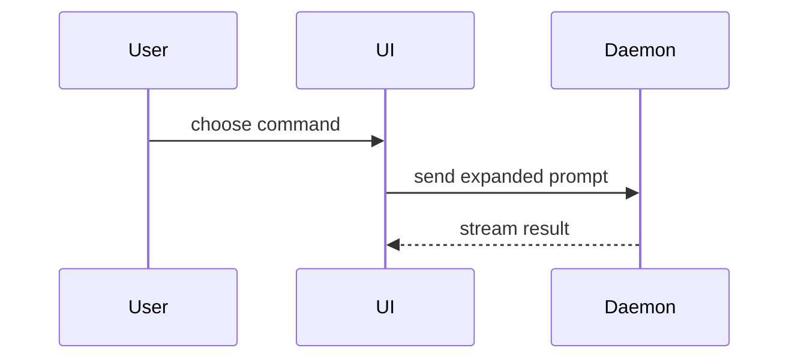

# agri-pr

## 工作流程

1. 確認目前所在分支（不可在 `main` 或 `develop` 上直接建立 PR）
2. 確認遠端有推送最新 commit（若未推送，先執行 `git push`）
3. 使用 `gh pr create` 建立 PR，目標分支預設為 `develop`
4. 根據 commit 紀錄生成 PR 標題
5. PR body 使用以下範本

## PR Body 範本

```markdown
## 變更摘要

<diagram, diff-sketch, or tree>

## 證據

- **Before:** <screenshot/output/failing test run>
  **After:** <screenshot/output/passing test run>

## 合併風險

**Door:** <one-way 或 two-way>

<optional: 描述>

**Blast Radius:** <一句話描述影響範圍>

<optional: 合併後可能造成的影響>
```

## 說明

PR 內容需省略所有前言，行文簡潔。

### 摘要

選擇最精簡、又能清楚呈現重點的方式。

- 用 pseudocode 呈現邏輯或演算法：

```text
on(save)
  if content is unchanged
    return cached result
  write new content
  return fresh result
```

- 用 call tree 呈現執行時的控制流程：

```text
submitForm
  createSession
    persistPrompt
    launchAgent
  navigateToSession
```

- 用 component tree 呈現 UI 結構，並標出重要的狀態與模組邊界：

```text
<SessionPage> (apps/example/src/routes/session.tsx)
  useSessionEvents()
  <SessionToolbar>
    <RunSkillButton> (packages/ui)
```

- 用簡要的 file tree 呈現各檔案的職責或大範圍重構：

```text
src/
├── commands/       # parses user actions
├── sessions/       # owns session state
└── transport/      # sends API requests
```

- 用 Mermaid 呈現元件互動、控制流程或資料流：



- 若重點在於變更之處，且原有結構已清楚，請使用 `diff`，並依主題選擇適合的呈現方式。

元件變更：

```diff
 <SessionPage>
   useSessionEvents()
   <SessionToolbar>
+    <RunSkillButton />
   <SessionTimeline>
+    <SkillResultCard />
```

檔案配置變更：

```diff
 src/
 ├── commands/
+│   └── show-me.ts       # expands the slash command
 ├── sessions/
-└── transport.ts
+└── transport/
+    ├── client.ts
+    └── stream.ts
```

call tree 或 call stack 變更：

```diff
 submitForm
   createSession
     persistPrompt
+    expandSkillMention
     launchAgent
-  navigateToSession
+  navigateToSession
+    subscribeToEvents
```

狀態或控制流程變更：

```diff
 on(save)
-  write content
+  if content is unchanged
+    return cached result
+  write new content
+  invalidate cache
```

- 如果大部分內容都是新的、省略上下文會讓職責歸屬或執行順序不清楚，或使用者需要可直接複製的完整形式，就呈現整個區塊：

```ts
function expandSkill(command: string): string {
  const skillName = command.slice(1);
  return `use the ${skillName} skill`;
}
```

#### 呈現原則

每個圖示都要緊接著它所輔助的簡短說明。只保留回答使用者目前問題，或釐清當前討論選項所需的呼叫、檔案、props、狀態與邊界。

可以只用一種，也可以搭配幾種；通常不需要全部用上。依情況選擇，避免資訊過多。

### 證據

提供變更確實可運作的具體證據，呈現變更前後的差異。

如果環境已備妥，而且變更涉及視覺呈現，截圖是 S-tier 證據。

執行結果是 A-tier 證據，例如測試結果或 console 輸出。用 pseudocode 呈現具體測試在變更前失敗、變更後通過的情況。

### 合併風險

說明這次變更屬於 one-way 還是 two-way door。two-way door 可以回頭，one-way door 則不行。容易還原的 PR 風險較低；涉及破壞性操作或難以撤銷的決策則屬於 one-way door。

Blast Radius 指這個 PR 可能影響的範圍。考量各種可能情況，例如版面位移、既有使用者的功能異常、行動裝置適應性等。

## 指令

```bash
# 推送當前分支（若尚未推送）
git push -u origin HEAD

# 建立 PR
gh pr create \
  --base develop \
  --title "<根據 commit 訊息與變更內容生成>" \
  --body "<PR Body 內容>"
```

## 注意事項

- 團隊 Gitflow：`feat/*` / `fix/*`／`chore/*` → `develop` → `main`（僅正式發佈用）
- PR 標題根據 commit 訊息與變更內容生成，不需使用者手動輸入
- 若 `develop` 分支不存在，先詢問使用者確認目標分支
