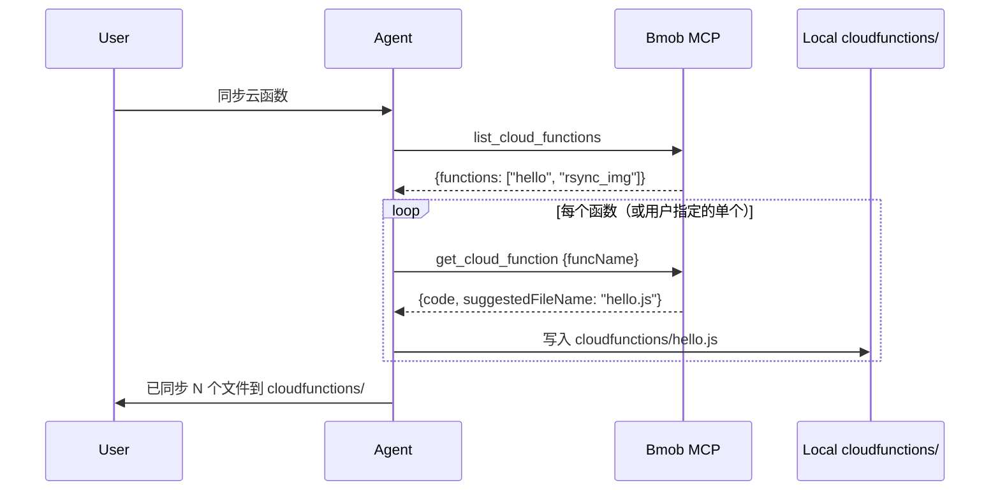

# Bmob 云函数开发

用于**写运行在 Bmob 服务器上的云函数源码**，并在已配置 MCP 时走 **`deploy_cloud_function` → `invoke_cloud_function`** 完成上传与验证，或走 **`list_cloud_functions` → `get_cloud_function`** 将线上函数同步到本地。

## 先判断走哪条通道

1. **已配置 Bmob MCP**：优先用 `bmob-mcp`
   - 上传源码：`deploy_cloud_function`
   - 单独验证：`invoke_cloud_function`
   - **同步线上 → 本地**：`list_cloud_functions` → `get_cloud_function`（agent 写本地文件）
2. **未配置 MCP**：按 [云函数文档](https://github.com/bmob/BmobDocs/blob/master/mds/cloud_function/web/develop_doc.md) 与 REST `/1/functions/<name>` / 控制台流程给代码与 curl

## 语法基线

默认按 Bmob 云函数文档的 Web/Node 风格写：

```javascript
function onRequest(request, response, modules) {
  response.send("hello");
}
```

- GET 直连参数：`request.query.xxx`
- POST / REST 参数：`request.body.xxx`
- 返回结果：`response.send(...)`
- 数据库 / 文件 / HTTP / 加密：从 `modules` 取 `oData`、`oFile`、`oHttp`、`oCrypto` 等

## 必须遵守的已知行为

- 通过 REST API 调用时，参数从 **`request.body`** 取，不是 `request.query`
- 云函数里很多回调返回的是**字符串**，需要 `JSON.parse(data)` 后再当对象用
- 已知行为：服务端可能把传入 `request.body` 的值转成字符串；涉及数字、布尔、数组、对象时，在云函数内显式 `parseInt` / `=== "true"` / `JSON.parse`
- **`modules.oData` 的 `where` 是 JSON 对象，不要 `JSON.stringify`**：
  - ✅ 云函数内：`db.find({ "table": "Level", "where": { "status": 1 } })`
  - ❌ 错误：`"where": JSON.stringify(where)` — 会把条件变成字符串，查询失效或行为异常
  - 仅 **REST GET 的 query 参数** `where` 才需要 URL 编码的 JSON 字符串（见 `bmob-database-restful`）；**不要**把 REST 写法套进 `oData`

## 默认工作流

### 1. 写源码

- 函数名与用户要调用的名字一致
- 优先写最小可验证版本，再逐步扩展
- 如果要查表 / 改表，先确认表名与字段名；用户已配 MCP 时先读 `get_project_tables`

### 2. 上传源码

已配 MCP 时，优先调用：

- `deploy_cloud_function`
  - `funcName`: 云函数名
  - `code`: 源码原文
  - `language`: `1`=javascript，`2`=java
  - `verify`: 需要立即验证时传 `1`
  - `verify_data`: 验证入参 JSON 字符串，默认 `{}` 

### 3. 验证结果

- 如果上传工具已设置 `verify=1`，直接检查返回里的 `verify.response`
- 如果需要多次验证，单独调用 `invoke_cloud_function`
- 验证失败时，优先把**上传结果**、**执行返回**、**传入参数**三者一起对照

### 4. 部署成功后：告知用户如何调用

`deploy_cloud_function` 成功时，响应里会带 **`invokeGuide`**。向用户说明调用方式时：

1. **禁止**只写裸 URL（如 `POST https://api.codenow.cn/1/functions/xxx`）——REST 必须带完整 headers 与 body
2. **优先**直接使用 `invokeGuide.rest.curl`（已含 `X-Bmob-Application-Id`、`X-Bmob-REST-API-Key`、`Content-Type` 与示例 body）
3. **按当前项目类型**只展示一种最匹配的 SDK 示例（从 `invokeGuide.sdk` 选取）：
   - 读代码库判断：`package.json` / Vue / React → `javascript`；`app.json` / 小程序 → `wechat_miniprogram`；`build.gradle` / Android SDK → `android`；`Podfile` / ObjC → `ios`；`BmobCloud.run` / SwiftPM → `swift`；`pubspec.yaml` / `bmob_plugin` → `flutter`；无 SDK 或用户要 curl → `restful`
   - 不确定时：REST curl + 说明「你的项目若是 XX 平台可参考 invokeGuide.sdk.XX」
4. 需要更详细的 curl 样板：可再调 `generate_code` → `type=调用云函数`
5. **展示完调用示例后，主动询问用户是否需要试跑**（已配 MCP 时）：
   - 话术示例：「云函数已部署。上面是 REST / SDK 调用方式。**需要我帮你用 MCP 模拟参数试跑一下吗？**」
   - 用户同意 → 根据云函数源码里 `request.body` 的字段，**推断或向用户确认**测试参数
   - 调用 `invoke_cloud_function`：`funcName` = 函数名，`data` = 测试入参的 **JSON 字符串**（如 `{"limit":10,"skip":0,"status":1}`）
   - 把执行结果（成功 / 报错 / 返回体）反馈给用户；失败时对照「上传结果 + 执行返回 + 传入参数」排查
   - 用户未配 MCP 或未同意试跑：只给调用说明，不自动执行

### MCP 试跑参数怎么构造

1. 读云函数源码，列出它从 `request.body` 读取的字段（如 `limit`、`skip`、`status`）
2. 给出一组**合理默认值**展示给用户，例如 `{ "limit": 10, "skip": 0 }`
3. 用户可修改或直接说「用这组参数测」
4. `invoke_cloud_function` 的 `data` 必须是 JSON 字符串：`"{\"limit\":10,\"skip\":0}"`

## 同步云函数（线上 → 本地）

**触发词**：`同步云函数`、`同步函数`、`拉取云函数`、`下载云函数`、`把线上云函数拉到本地`。

已配 MCP 时按以下流程执行（MCP 拉取 + agent 写盘）：



### 1. 拉取线上列表与源码

1. 调用 `list_cloud_functions` 获取 `functions` 数组
2. 若用户指定了单个函数名（如「同步 hello」），可跳过 list，直接 `get_cloud_function`
3. 对每个名称调用 `get_cloud_function`；响应里 `code` 已是明文，`suggestedFileName` 为推荐文件名（如 `hello.js`）

### 2. 确定本地目录

按优先级查找现有云函数目录：

1. `cloudfunctions/`
2. `bmob/cloud-functions/`
3. `functions/`

**若均不存在**，在项目根目录创建 **`cloudfunctions/`**。

### 3. 写入文件

- 路径：`{目录}/{suggestedFileName}`（如 `cloudfunctions/hello.js`）
- 内容：`get_cloud_function` 返回的 `code` 字段原文
- 若本地已有同名文件：先告知用户将覆盖，或询问是否保留本地版本

### 4. 汇报结果

向用户说明：同步了哪些函数、写入路径、语言类型（`languageName`）。

未配 MCP 时：给出 REST curl 样板（`GET /1/functions` 与 `GET /1/functions/<name>`），并说明需自行 base64 解码 `code` 字段。

## 推荐验证方式

### 无参数函数

```json
{
  "verify": 1,
  "verify_data": "{}"
}
```

### 有参数函数

让 `verify_data` 精确匹配要验证的场景，例如：

```json
{
  "verify": 1,
  "verify_data": "{\"name\":\"tom\",\"count\":1}"
}
```

## 常见模式

### 返回简单字符串

```javascript
function onRequest(request, response, modules) {
  response.send("ok");
}
```

### 读取 POST 参数

```javascript
function onRequest(request, response, modules) {
  var name = request.body.name || "guest";
  response.send("hello " + name);
}
```

### 查表后返回结果

```javascript
function onRequest(request, response, modules) {
  var db = modules.oData;
  db.find({"table":"Games"}, function(err, data) {
    if (err) {
      response.send(err);
      return;
    }
    response.send(JSON.parse(data));
  });
}
```

### 条件查询 + 分页（where 传对象）

```javascript
function onRequest(request, response, modules) {
  var db = modules.oData;
  var limit = parseInt(request.body.limit, 10) || 10;
  var skip = parseInt(request.body.skip, 10) || 0;
  var where = { "status": 1 };
  if (request.body.status !== undefined) {
    where.status = parseInt(request.body.status, 10);
  }
  db.find({
    "table": "Level",
    "limit": limit,
    "skip": skip,
    "order": "sortOrder",
    "where": where
  }, function(err, data) {
    if (err) {
      response.send(err);
      return;
    }
    response.send(JSON.parse(data));
  });
}
```

> `where` 直接传对象。`order` 前缀 `-` 表示降序（如 `"-sortOrder"`）。`limit` / `skip` / `count` 为数字。

## 反模式

| 错误写法 | 后果 | 正确写法 |
|---|---|---|
| `"where": JSON.stringify(where)` | 条件变字符串，查不到或行为异常 | `"where": where` 或内联 `{"status": 1}` |
| 把 REST 的 `encodeURIComponent(JSON.stringify(where))` 套进 `oData` | 同上 | 云函数 `oData` 与 REST query 是两套 API |
| 云函数回调里直接用 `data.xxx` 不 parse | `data` 是 string，属性访问失败 | 先 `JSON.parse(data)` |

## 失败时怎么处理

- 云函数不存在：确认 `funcName` 与上传目标一致
- 验证返回结构不对：检查用的是 `request.body` 还是 `request.query`
- 数字/布尔判断异常：按“值会变字符串”处理
- 数据库回调类型不对：先 `JSON.parse(data)`
- 条件查询无结果 / 查全表：`where` 是否误用了 `JSON.stringify`；应传对象
- 仍失败：回到最小版本，只保留 `response.send("ok")` 验证发布链路

## 何时降级

以下情况不要硬走自动上传：

- 用户没有配置 MCP
- 需要大体量源码而工具入参不方便承载时
- 用户明确只要示例代码，不要真实部署

此时提供源码 + REST 上传说明，并明确未做在线验证。
