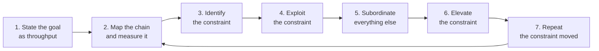

#  fix-the-bottleneck

> **How to read this**
>
> - **Agents:** Follow **Agent guardrails** and the **Core procedure** literally. The constraint is named from measurements, never from opinion, and a fix is not done until system throughput moves.
> - **Humans:** Run the **Core procedure** on one chain at a time. Open `references/` for the five focusing steps in depth, the flow math, and the worked case.
> - **Index:** [`references/README.md`](references/README.md) · **Public overview:** [`README.md`](README.md)

**Not a substitute for domain expertise.** This skill is an operations procedure for flow systems. It does not override measured evidence, regulation, safety constraints, or licensed professional advice — see **Agent guardrails**.

## Sources

Full credit table — the books and papers behind this skill: [`references/sources-and-urls.md`](references/sources-and-urls.md). The method is Eliyahu M. Goldratt's Theory of Constraints, introduced in *The Goal* (1984). The flow math is Donald Reinertsen's, the software translation is *The Phoenix Project* and *Accelerate*, and the elevate step runs Elon Musk's Algorithm, which the first-principles skill already carries.

## When to use

Use this skill when a **founder**, **operator**, **engineer**, or delegated agent faces:

- A **running system whose output is below target** — a delivery pipeline, a CI/CD chain, a support operation, an agent fleet — where work is plentiful and finished output is not.
- **Whack-a-mole fixing**: local fixes keep landing, their own metrics improve, and total output does not move.
- A **queue nobody can explain**: work piles up in front of one stage and starves behind it, while every stage reports itself busy.
- A **capacity decision**: hire, buy, add machines, add agents — where the question is whether the constraint is actually the thing being bought.
- A **single point of failure**: one person, one lane, one service that everything routes through.

## When NOT to use

- **The system is not running yet.** A design that does not exist has no constraint to measure. Use first-principles thinking to design it; use this skill once it flows.
- **The problem is one decision, not a flow.** A price, a hire, a build-vs-buy call: decompose it with first-principles thinking. This skill governs chains that repeat.
- **Another actor's choices set the output.** When a counterparty, a competitor, or a market is the limiting factor, that is a game; use game-theory-for-decisions.
- **Output is at target.** Constraint management is a loop for systems that miss their goal. Running it on a healthy system manufactures work.
- **There are no measurements and none can be taken.** The procedure's first move is to instrument. If instrumentation is impossible, say so and stop; a constraint named without evidence is a guess wearing a method.

## Agent guardrails

1. **Measure before naming.** The constraint is identified from stage measurements: where the queue grows, where downstream starves, which stage has the lowest effective capacity. A stage everyone dislikes is not evidence. If the measurements do not exist, the deliverable is the instrumentation plan, not a verdict.
2. **One constraint at a time, per chain.** A chain has one binding constraint at a time. Naming three constraints is naming none. Secondary limits go in a watch list, worked only after the binding one moves.
3. **Exploit and subordinate before elevating.** Getting more from the constraint as it stands, and aligning the rest of the system to it, come before any spend on capacity. Elevating first is the classic error: it is expensive and usually unnecessary once exploitation is done.
4. **Local improvement is not progress.** A fix counts only when system throughput moves, over a sustained window named in advance. A failure class dropping while output stays flat means the fix was not at the constraint, or the constraint has already moved.
5. **Protect the constraint's input.** Work reaches the constraint complete, checked, and ready. Defects are caught before the constraint, never after: an hour the constraint spends on bad input is an hour of system output lost.
6. **Utilization is not a goal.** A non-constraint running at full utilization builds inventory in front of the constraint and lengthens every cycle time. Deliberate slack at non-constraints is correct, not lazy.
7. **Name the unnamed.** In any failure accounting, the share of failures matching no named class is a first-class metric, reported beside the named classes. An unnamed failure cannot be fixed; it can only be retried, and retries consume the constraint.
8. **Every fix carries its expected effect.** State, before the fix: which stage it moves, the expected change in that stage's rate, the resulting expected system throughput, and the window over which it will be judged. A fix with no expected effect is an activity, not a fix.
9. **Beware the hero constraint.** When the constraint is one person or one lane that everything routes through, the plan includes removing the single point of failure (document, cross-train, split the knowledge), not only protecting its time. Protection without de-risking deepens the dependency.
10. **Do not let inertia become the constraint.** Rules written for a previous constraint — holds, approvals, routing, limits — are audited at every repeat. Yesterday's protection is a common form of today's constraint.
11. **Throughput accounting governs trade-offs.** Judge a change by its effect on throughput first, then on inventory (work in progress), then on operating expense. A change that cuts expense while cutting throughput is a loss, whatever the expense report says. See [`references/throughput-accounting.md`](references/throughput-accounting.md).
12. **Write the output plain.** Short sentences, one idea per sentence, plain words, rates as percentages with their counts beside them. If the constraint verdict needs a paragraph to explain, the evidence chain is not clear yet.
13. **State the count behind every rate, and label small-cohort verdicts provisional.** A rate drawn from a handful of cases is a hint, not a measurement. Where the evidence for a stage is a small cohort, the finding is labeled provisional, its count is stated, and the run names the cohort size that would settle it. A provisional finding goes on the watch list with its settling condition; it never carries an elevate spend.

## The one idea

Every chain that produces finished output is limited, at any moment, by **one constraint**. Output cannot exceed what the constraint passes, no matter how hard every other stage works.

Goldratt's sharp formulation: **an hour lost at the constraint is an hour lost for the entire system; an hour saved at a non-constraint is a mirage.**

This is why well-run systems still miss: effort spreads evenly, or follows whoever complains loudest, while the one stage that sets the rate gets the same share as every other stage. The method exists to concentrate effort where the system's rate is actually set, in the right order: squeeze the constraint first, align everything else to it, spend on it last, and start over when it moves — because it will move.

First-principles thinking takes one thing apart and rebuilds it better. This skill is the companion for a system that already runs: it finds where the running system loses its output, and in what order to fix the losses. The two meet inside step 6, where a constraint that needs rebuilding gets decomposed properly.

## What a run returns

Every run of this skill returns, in this order:

1. **The goal**: the finished unit, its current rate, the target rate, and the window both are measured over.
2. **The chain map**: each stage with its input rate, success rate, wait time, and work in progress, and the output equation that multiplies out to the current rate.
3. **The constraint verdict**: the one binding constraint, the evidence that names it (queue before it, starvation after it, lowest effective capacity), its kind (resource, policy, hero, or external), the classification of the losses inside it by kind with the unnamed share stated, and the watch list of near-constraints — each watch item labeled provisional with its count where its evidence is a small cohort.
4. **Exploit list**: how to get more from the constraint as it stands, ordered by expected effect.
5. **Subordinate list**: what the rest of the system must stop, throttle, or re-sequence to serve the constraint, including the work-in-progress cap.
6. **Elevate list**: capacity or redesign moves, in Musk's Algorithm order, each with its expected effect on the stage rate and on system throughput.
7. **The re-measure plan**: the window, the rates that will be re-read, and the done rule — the throughput level that counts as the fix having worked.
8. **The inertia watch**: the rules and holds written for previous constraints that this run flags for audit at the next repeat.

## Core procedure

Run all seven steps, in order, on **one** named chain. Depth material for each step is linked; the skeleton here is the whole method.

### 1 — State the goal as throughput

Write down: the **finished unit** the chain exists to produce (a merged change, a shipped order, a resolved ticket), its **current rate** (units per hour, day, or week), the **target rate**, and the **measurement window**.

- The unit is finished output only. Started work, opened items, and attempts are inputs to the math, never the goal.
- If the current rate cannot be stated, instrument first. A rate reconstructed from memory is not a rate.

### 2 — Map the chain and measure every stage

Draw the chain as the stages a unit passes through, in order. For each stage record: **input rate**, **success rate** (share of inputs that leave as good output), **average wait** before the stage, and **work in progress** sitting in front of it.

Multiply the chain out: input rate × each stage's success rate = output rate. The equation must reproduce the measured output from step 1; if it does not, a stage or a loss is missing, and finding it is the work of this step. Scope discipline: every rate in the equation must describe the same population as the output rate — one producer, one chain, one window. Rates pooled across producers or windows will fail the equation check spuriously and hide the real constraint; when a check fails, audit the scopes before hunting for a missing stage.

Two flow laws govern this map (full treatment: [`references/flow-math.md`](references/flow-math.md)):

- **Little's Law**: cycle time = work in progress ÷ throughput. At a fixed throughput, more work in progress means every unit waits longer. There is no exception for knowledge work.
- **The utilization curve**: as a stage's utilization approaches 100%, its queue grows without limit. A stage kept fully busy is a stage building a queue.

### 3 — Identify the constraint

The constraint is the stage the evidence points at: the **queue grows in front of it**, stages **behind it starve** for input, and its **effective capacity is the lowest** in the chain once its success rate is counted. Name one. Record its kind ([`references/constraint-kinds.md`](references/constraint-kinds.md)):

- **Resource**: a stage that cannot pass more work — too slow, too few, too unreliable.
- **Policy**: a rule, approval, hold, or routing decision that limits flow. Policy constraints are the most common in knowledge work and the cheapest to fix, because nothing physical has to change.
- **Hero**: one person, lane, or service everything routes through.
- **External**: a provider, market, or counterparty outside the system's control.

One check before the kind is trusted: **does the stage actually occur in the system's real schedule?** A stage that never runs because its slot is fictional — scheduled into time the system never has, dependent on a step nobody performs — is not a policy constraint, however rule-shaped it looks. It is a design error, and its fix belongs to step 6's redesign, not to the slot protection in step 4. Protecting a fictional slot produces a plan that fails politely every day.

Then **classify the losses inside the constraint**: break its failures into named classes with their shares, and tag each class with the same four kinds. The exploit list in step 4 is written against these classes, largest first — a constraint whose losses are mostly policy is fixed with rule changes, not capacity, and a constraint whose losses are mostly unnamed is fixed first with instrumentation. The share matching no named class is reported as its own line, never folded into a named class to make the accounting look complete.

Depth: Goldratt's five focusing steps, which steps 3–7 of this procedure operationalize, are in [`references/five-focusing-steps.md`](references/five-focusing-steps.md).

### 4 — Exploit the constraint

Get the most from the constraint **as it stands**, before any spend:

- **Never let it idle** for want of ready input: keep a small, deliberate buffer of checked work in front of it.
- **Never let it work on bad input**: inspect before the constraint, not after. Reject or repair upstream.
- **Strip its non-essential work**: anything the constraint does that another stage could do comes off it.
- **Cut its unplanned work**: emergencies and drive-by requests that consume the constraint are routed, batched, or refused; unplanned work is a tax paid at the system's most expensive rate.
- **Fix its largest named failure classes first**, ranked by share of its losses — and name the unnamed share before retrying it (guardrail 7).

### 5 — Subordinate everything else to the constraint

Align the whole chain to the constraint's pace:

- **Throttle intake** to what the constraint can pass. Starting work the system cannot finish adds inventory, not output.
- **Cap work in progress** per stage. When a stage hits its cap, it stops taking work, and the stoppage is the signal that surfaces the next problem.
- **Re-sequence for the constraint**: upstream stages prepare work in the order and completeness the constraint needs, even when that is locally less efficient for them.
- **Let non-constraints run below capacity.** Their slack is what absorbs variation and keeps the constraint fed.

### 6 — Elevate the constraint

Only now, spend: add capacity, add a parallel lane, or redesign the stage. Run the redesign in Musk's Algorithm order — question every requirement the stage carries, delete parts and steps, simplify what remains, accelerate cycle time, automate last. Automating a stage that should not exist locks the waste in.

Where the stage's design itself is the problem, decompose it with first-principles thinking and rebuild from the floor. State the expected effect before starting (guardrail 8): the stage rate it should produce and the system throughput that follows.

### 7 — Repeat, and guard against inertia

When throughput moves, the constraint has moved. Return to step 2 with fresh measurements and find the new one.

At every repeat, audit the rules the system wrote for the old constraint — holds, approvals, caps, routing — and retire or re-justify each. Goldratt's warning stands as the step's name in the original method: do not allow inertia to become the system's constraint.

The run is done when the re-measure plan from the output contract has been read and judged against its done rule, not when the fixes have shipped.

## Limits and boundaries

- **One chain, one constraint.** A system with several independent chains needs one run per chain. Forcing two chains into one map produces a constraint that belongs to neither.
- **Not a substitute for first-principles thinking.** This skill finds *where* a running system loses output and the *order* to fix the losses in. It does not decompose a stage's design or price its floor; step 6 hands that work to first-principles thinking and takes the rebuilt stage back.
- **Not a substitute for game theory.** When the constraint is another actor's choice — a provider's limits, a reviewer's incentives, a counterparty's pace — the constraint verdict names it as external, and game-theory-for-decisions works out the moves. This skill still owns the measurement: how much output the external constraint costs.
- **Measurement has a cost.** Instrumenting a chain takes real work. For a chain whose output shortfall is cheap, the honest recommendation is to accept the shortfall; the procedure says so at step 1 rather than after a week of mapping.
- **The map is a snapshot.** Rates move with load, season, and mix. A constraint verdict expires; the re-measure plan is part of the method, not an optional follow-up.

## Verification checklist

Before calling a run complete, confirm:

- [ ] The goal names a finished unit, a current rate, a target rate, and a window.
- [ ] The stage equation multiplies out to the measured output rate, or the gap is named as a finding.
- [ ] Every rate in the equation is scoped to the same population and window as the output rate.
- [ ] Exactly one constraint is named, with queue, starvation, and capacity evidence.
- [ ] The constraint's kind is recorded, and near-constraints sit in a watch list, not the verdict.
- [ ] Exploit and subordinate lists exist and are ordered before any elevate spend.
- [ ] Every elevate item states its expected effect on the stage rate and on system throughput.
- [ ] A work-in-progress cap and an intake rule are set, in writing.
- [ ] The failure accounting reports the unnamed share beside the named classes.
- [ ] The constraint's losses are classified by kind, and the exploit list is ordered against the largest classes.
- [ ] The constraint's stage is verified to occur in the system's real schedule — no fictional slot is being protected.
- [ ] Every rate carries its count, and any finding resting on a small cohort is labeled provisional with its settling cohort size named.
- [ ] The re-measure window and done rule are stated, and the inertia watch names the old rules to audit.
