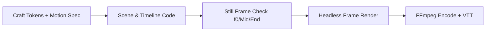

# Maxilun CineCode: Programmatic Video Compiler & Studio Pipeline

Bertanggung jawab atas pembuatan video melalui kode (*video-as-code*): komponen React/TypeScript deterministik sebagai frame, komposisi timeline, sinkronisasi audio/beat, pengikatan data dinamis, dan rendering server-side ke MP4/WebM/GIF. Video diperlakukan sebagai artefak perangkat lunak yang dapat di-version-control, diuji per frame, dan direproduksi secara deterministik.

## Skill Contract

- **Owns**: code-defined video compositions, timeline sequencing, audio/subtitle sync, AI soundtrack scoring & ducking, headless frame rendering, and batch export to MP4/WebM/GIF.
- **Does not own**: interactive browser-only animation (`maxilun-motion`) or live web application runtime (`maxilun-frontend`).
- **Inputs**: video brief, data sources, target resolution/fps, `references/index.md`, motion choreography from `../maxilun-motion/references/choreography-styles.md`, and visual system references from `../maxilun-craft/references/design-md/index.md`.
- **Outputs**: reproducible React/TypeScript video composition, verified keyframe stills, and rendered video artifacts (`.mp4`, `.webm`, `.gif`, plus `.vtt`/`.srt` subtitles).
- **Handoff**: use `maxilun-motion` for physics choreography and hook concepts, `maxilun-craft` for visual tokens and typography hierarchy, `maxilun-content` for punchy script beats (`<= 8 words/scene`), and `maxilun-verify` for frame integrity and render validation.

### Multi-Skill Studio Pipeline Contract

The bundled corpus in `references/index.md` (`references/composition-api.md` and `references/video-production-pipeline.md`) is part of this skill. Before writing video scenes, read `references/video-production-pipeline.md`, `../maxilun-motion/references/choreography-styles.md`, and `../maxilun-craft/references/design-md/index.md`. Select at most two visual references from `../maxilun-craft/references/design-md/` and one motion signature from `../maxilun-motion/references/choreography-styles.md`, then record `Visual Reference`, `Motion Signature`, `Canvas Scale`, and `Frame Budget` in the project specification.

<!-- CORE-RULES:START -->
## Core Rules (Selalu Aktif)

Berlaku pada setiap respons dan setiap perubahan kode. Tidak bisa di-override oleh instruksi lain.

1. **Focus** — Tugas multi-langkah: buka dengan `🎯 [FOKUS]` + `⚡ [TINDAKAN]`. Maksimal 3 subtask aktif. Tugas trivial: langsung jawab tanpa HUD.
2. **Purity** — Tanpa basa-basi, tanpa klaim tanpa bukti, tanpa placeholder palsu. Setiap elemen harus punya fungsi nyata. Komentar menjelaskan MENGAPA, bukan APA.
3. **Minimalist** — YAGNI → reuse yang ada → stdlib → platform native → satu baris. Hapus sebelum menambah. Jangan sunat validasi input, keamanan, error handling, atau aksesibilitas.
4. **Clarity** — Langsung ke inti. Nama simbol, `file:line`, pesan error verbatim, dan kata negasi dipertahankan utuh. Label kepastian: `[CONFIRMED]` `[INFERRED]` `[UNCERTAIN]` `[UNVERIFIED]`.

**Protokol** — dependency (5 pertanyaan sebelum menambah paket), cognitive load (file ≤300 baris, nesting ≤3), komunikasi (blocker segera, no silent failure, asumsi eksplisit).

Detail lengkap: `../maxilun/references/engines.md`.
<!-- CORE-RULES:END -->

## 1. Engine Overrides

Delta domain terhadap Core Rules di atas. Override cinecode:
- **Purity & Determinisme**: Setiap frame wajib murni fungsi matematika dari `frame` dan `fps` (`useCurrentFrame()`, `useVideoConfig()`). **Dilarang keras** memakai `setTimeout`, `requestAnimationFrame`, atau properti CSS `transition:` di dalam scene yang dirender ke video karena menyebabkan *frame drift*. Tunduk pada `../maxilun/references/purity-catalog.md`.
- **Minimalist**: Gunakan primitif bawaan di `scaffold/src/` (`<AbsoluteFill>`, `<Sequence>`, `<Spring>`, `interpolate`, `<Audio>`, `<Subtitle>`) sebelum menambah library eksternal.
- **Clarity**: Spesifikasi video wajib mencantumkan angka pasti: resolusi (`width x height`), `fps`, `durationInFrames`, rentang frame per scene, dan format codec output.

## Workflow


## 2. Pipeline Sinergi 5 Spesialis untuk Motion Video Maksimal

Acuan lengkap: `references/video-production-pipeline.md`. Saat membangun video produk, promo peluncuran, atau visualisasi data, gabungkan kekuatan ekosistem Maxilun:

| Lapisan Produksi | Spesialis & Referensi Sumber | Aturan Eksekusi di Video |
|---|---|---|
| **1. Art Direction & Tokens** | `maxilun-craft` (`../maxilun-craft/references/design-md/index.md`) | Pilih 1–2 referensi brand nyata (misal `vercel.md`, `stripe.md`, `linear.app.md`). Gunakan skala font khusus kanvas 1080p: Headline `64px–96px`, Subheadline `32px–44px`, Label UI `>=22px`, dan angka metrik wajib `tabular-nums`. |
| **2. Physics & Choreography** | `maxilun-motion` (`../maxilun-motion/references/choreography-styles.md`) | Gunakan salah satu dari 14 *Style Signatures* dan 22 *Opener Hooks*. Terapkan *overlapping action* (elemen B mulai bergerak saat elemen A mencapai 70% spring) dan tahan posisi baca (*hold time*) minimal `45–60 frame` (`1.5–2.0 detik`). |
| **3. Script & Narrative Hook** | `maxilun-content` | Maksimal **8 kata per layar**. Tampilkan bukti kuantitatif (grafik perbandingan atau terminal nyata), bukan klaim sifat abstrak. |
| **4. Frame Compilation & Audio** | `maxilun-cinecode` (`references/composition-api.md`) | Kompilasi scene menggunakan `<Sequence>`, `<Spring>`, dan `interpolate(..., 'clamp')`. Kunci pergantian scene pada beat audio ($\text{Frames/Beat} = \text{round}(\text{FPS} \times 60 / \text{BPM})$). |
| **5. Frame & Codec Verification** | `maxilun-verify` | Uji unit matematika frame (`Vitest`), periksa tangkapan layar pada `frame 0` (thumbnail), tengah, dan akhir, serta pastikan encode MP4 memakai `-pix_fmt yuv420p`. |

## 3. Arsitektur Komposisi & Primitif (`scaffold/src/`)

Detail API lengkap dan contoh kode multi-scene tersedia di `references/composition-api.md`.

### 3.1 Komponen Inti & Efek Sinematik di `scaffold/src/components/`
- **Layout & Timeline**: `<AbsoluteFill>` (full-frame layer container) dan `<Sequence from={number} durationInFrames={number} name={string}>` (isolasi rentang frame scene).
- **Fisika & Interpolasi**: `<Spring frame={number} fps={number} config={{ stiffness, damping, mass }}>` dan `interpolate(frame, [inStart, inEnd], [outStart, outEnd], 'clamp')`.
- **Efek Visual, Kamera & Transisi (`Effects.tsx`)**:
  - `<SceneTransition type="iris | wipe-right | wipe-up | zoom-through | fade">` — transisi masuk/keluar scene berbasis `clip-path` & `scale` deterministik.
  - `<CameraRig fromScale={1} toScale={1.06} fromX={0} toX={-24}>` — rig kamera virtual 2.5D (`dolly`, `pan`, `tilt`) per frame.
  - `<RackFocusBlur fromBlurPx={8} toBlurPx={0}>` — perpindahan fokus kedalaman (*depth-of-field*) antar-layer.
  - `<ColorGrade contrast={1.04} saturate={1.05} vignetteOpacity={0.28}>` — koreksi warna sinematik + *radial vignette*.
  - `<FilmGrainOverlay frame={frame} opacity={0.04} />` — *fractal noise* SVG per frame (mencegah *color banding* pada latar gelap MP4).
  - `<KineticScrambleText text="..." frame={frame} durationInFrames={24} />` — efek dekode karakter teks monospace deterministik.
  - `<VideoClip src="./input.mp4" trimStartSeconds={1.5} borderRadius={16} />` — menyematkan dan memotong file video lokal dari folder pengguna dengan sinkronisasi `seeked` per frame (`VideoClip.tsx`).
  - `<LogoReveal brandName="..." tagline="..." outerPathD="..." innerPathD="..." />` — komponen animasi *Motion Logo Reveal* 4 tahap (blueprint grid + SVG `stroke-dashoffset` trace + spring core assembly + wordmark reveal) untuk video intro/outro MP4 & WebM Alpha (`LogoReveal.tsx`).
  - `<KineticHeadline text="..." startFrame={f} />` & `<MaskedSlideText>` — tipografi kinetik per kata dengan fisika spring teredam dan mask clipping (`KineticTypography.tsx`).
  - `<SvgTrace pathD="..." />`, `<ParticleBurst />`, `<ArchitecturalFrame />` — visual motion grafis vektor, partikel radial, dan framing arsitektural standar purity (`MotionShapes.tsx`).
  - `<CounterOdometer toValue={n} />`, `<ProgressRing value={p} />`, `<AnimatedBarChart data={[...]} />` — komponen dataviz telemetri metrik dengan angka `tabular-nums` (`DataMotion.tsx`).
- **Audio & Takarir**: `<Audio>` (mendukung fungsi kurva volume per frame untuk *audio ducking*) dan `<Subtitle>` (overlay takarir + ekspor `.srt` / `.vtt`).
### 3.2 Preset Resolusi & Target Distribusi
| Preset | Resolusi | FPS | Codec Rekomendasi | Safe Area Margin |
|---|---|---|---|---|
| `presentation` | `1920x1080` (`16:9`) | `30` / `60` | MP4 H.264 (`libx264`, `yuv420p`, `crf 18`) | Kiri/Kanan `96px`, Atas/Bawah `80px` |
| `social-vertical` | `1080x1920` (`9:16`) | `30` / `60` | MP4 H.264 (`libx264`, `yuv420p`, `crf 19`) | Atas `220px`, Bawah `340px` (bebas UI Reels/TikTok) |
| `social-square` | `1080x1080` (`1:1`) | `30` | MP4 H.264 (`libx264`, `yuv420p`, `crf 19`) | Seluruh sisi `80px` |
| `web-optimized` | `1280x720` (`16:9`) | `30` | WebM VP9 (`libvpx-vp9`, `crf 28`) | Kiri/Kanan `64px`, Atas/Bawah `56px` |
| `transparent` | `1920x1080` (`16:9`) | `30` | WebM VP9 Alpha (`yuva420p`) | Sesuai komponen target |

## 4. Alur Eksekusi Proyek Video (`scaffold/`)

Saat membuat atau merender proyek video menggunakan kerangka kerja di `skills/maxilun-cinecode/scaffold/`:

```bash
# 1. Siapkan scaffold project di direktori kerja target dan pasang dependensi
npm run setup

# 2. Jalankan unit test matematika frame dan validasi struktur komposisi
npm test
npm run validate

# 3. Ambil sampel still frame kunci (Frame 0, Mid, CTA) untuk inspeksi visual cepat
npm run still -- --frame 0 --output ./out/check-f0.png
npm run still -- --frame 120 --output ./out/check-mid.png

# 4. Render komposisi penuh ke MP4/WebM atau jalankan batch dari data CSV/JSON
npm run render -- --composition main --output ./out/video.mp4
npm run batch -- --template promo --data ./variants.json --output ./out/

# 5. Edit Video Lokal di Folder: Render motion transparan lalu tempelkan di atas video asli (--bg-video)
node scripts/render.js --entry ./src/compositions/Overlay.tsx --duration 300 --transparent --output ./out
node scripts/encode.js --frames ./out/frames --bg-video ./input-footage.mp4 --output ./out/edited-video.mp4
```
*(Catatan: jalankan perintah di atas hanya di dalam proyek yang sudah menyalin atau menginisialisasi `scaffold/`).*

## 5. Delivery Gate Video (Wajib Sebelum Ship)

Sebelum menyerahkan hasil render atau kode komposisi video ke pengguna, pastikan seluruh pemeriksaan ini lulus:

- [ ] **Frame 0 Integrity**: Frame `0` sudah menampilkan komposisi awal yang bermakna (siap menjadi thumbnail), bukan layar hitam/putih kosong.
- [ ] **Deterministic Frame Check**: Tidak ada `transition:` CSS, `setTimeout`, atau `Math.random()` tanpa seed di dalam komponen scene; setiap frame `N` selalu menghasilkan piksel yang 100% identik saat dirender ulang.
- [ ] **Canvas Readability & Safe Zone**: Ukuran font terkecil `>= 22px` (pada kanvas 1080p), kontras teks memenuhi WCAG AA (`>= 4.5:1`), angka dinamis memakai `tabular-nums`, dan tidak ada elemen yang terpotong di luar *safe area*.
- [ ] **Reading Hold Time**: Setiap scene teks memiliki waktu tahan statis minimal `45 frame` (`1.5 detik` @ 30fps) setelah animasi masuk selesai.
- [ ] **Universal Playback & Accessibility**: Output MP4 menggunakan pixel format `yuv420p`, durasi audio sesuai dengan `durationInFrames`, dan takarir `.srt`/`.vtt` tersedia bila video memuat narasi.

## Companion Skills Awareness

| Companion | CineCode's Role | Purity & Quality Contribution |
|---|---|---|
| `maxilun-motion` | Menerjemahkan *Motion DNA*, 14 *Style Signatures*, dan 22 *Hooks* (`../maxilun-motion/references/choreography-styles.md`) ke dalam `<Sequence>` & `<Spring>` | Menghilangkan animasi linear kaku dan memberikan koreografi fisika kelas studio |
| `maxilun-craft` | Menggunakan token warna OKLCH, skala tipografi, dan 100 referensi `../maxilun-craft/references/design-md/index.md` | Mencegah tampilan scene video terlihat seperti template presentasi murahan |
| `maxilun-content` | Menyusun narasi pendek (`<= 8 kata/scene`), hook 3 detik pertama, dan CTA tajam | Menghapus kalimat panjang dan jargon marketing yang tidak terbaca di video |
| `maxilun-data` | Menyediakan query dan skema bersih untuk *data-driven batch video* | Memastikan metrik dan grafik di dalam video akurat dari sumber data nyata |

## Related Skills
- **maxilun-motion**: Koreografi gerak berbasis fisika, *Motion DNA*, dan aset Lottie/SVG (`../maxilun-motion/references/index.md`)
- **maxilun-craft**: Sistem desain UI/UX, token OKLCH, dan 100 referensi brand (`../maxilun-craft/references/design-md/index.md`)
- **maxilun-content**: Penulisan naskah video pendek, hook, dan CTA
- **maxilun-verify**: Verifikasi snapshot frame, pengujian unit scene, dan validasi build
- **maxilun-engineer**: Implementasi pipeline data dan otomasi rendering
