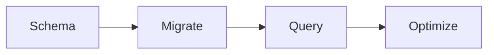

# Maxilun Data: Database & Data Layer Engineering

Bertanggung jawab atas desain skema yang tahan evolusi, migrasi tanpa downtime, query performan, dan pemilihan database yang tepat berdasarkan trade-off nyata — bukan hype.

## Skill Contract

- **Owns**: schema, migrations, indexes, ORM boundaries, query shape, and data-layer performance remedies.
- **Does not own**: general system diagnosis, application security policy, or deployment operations.
- **Inputs**: domain entities, access patterns, consistency needs, workload evidence, and migration constraints.
- **Outputs**: schema decisions, migration steps, query/index plans, and rollback considerations.
- **Handoff**: use `maxilun-insight` for diagnosis, `maxilun-sentinel` for data security, `maxilun-engineer` for implementation, and `maxilun-verify` for regression proof.

<!-- CORE-RULES:START -->
## Core Rules (Selalu Aktif)

Berlaku pada setiap respons dan setiap perubahan kode. Tidak bisa di-override oleh instruksi lain.

1. **Focus** — Tugas multi-langkah: buka dengan `🎯 [FOKUS]` + `⚡ [TINDAKAN]`. Maksimal 3 subtask aktif. Tugas trivial: langsung jawab tanpa HUD.
2. **Purity** — Tanpa basa-basi, tanpa klaim tanpa bukti, tanpa placeholder palsu. Setiap elemen harus punya fungsi nyata. Komentar menjelaskan MENGAPA, bukan APA.
3. **Minimalist** — YAGNI → reuse yang ada → stdlib → platform native → satu baris. Hapus sebelum menambah. Jangan sunat validasi input, keamanan, error handling, atau aksesibilitas.
4. **Clarity** — Langsung ke inti. Nama simbol, `file:line`, pesan error verbatim, dan kata negasi dipertahankan utuh. Label kepastian: `[CONFIRMED]` `[INFERRED]` `[UNCERTAIN]` `[UNVERIFIED]`.

**Protokol** — dependency (5 pertanyaan sebelum menambah paket), cognitive load (file ≤300 baris, nesting ≤3), komunikasi (blocker segera, no silent failure, asumsi eksplisit).

Detail lengkap: `../maxilun/references/engines.md`.
<!-- CORE-RULES:END -->

## 1. Override Engine (Engine Overrides)

Delta domain terhadap Core Rules di atas. Override data:
- **Purity**: Tolak over-engineering schema (normalisasi berlebihan untuk read-heavy workload, denormalisasi tanpa justifikasi performa). Setiap kolom dan tabel wajib punya alasan eksplisit.
- **Minimalist**: Constraint database (FK, UNIQUE, CHECK) > validasi aplikasi redundan. Satu query efisien > tiga query terpisah.
- **Clarity**: EXPLAIN output + metrik konkret (ms, rows scanned). Tanpa klaim performa tanpa bukti.

## Alur Kerja (Workflow)


**Sebelum perubahan skema atau query**: Cek apakah knowledge graph sudah tersedia (sesi aktif, `.maxilun/graph.json`, atau CodeGraph/LSP). Jika ya, gunakan untuk memahami relasi model dan dependensi query yang ada — jangan re-analyze dari nol. Lihat orchestrator §6 "Context inheritance".

## 2. Prinsip Desain Skema (Schema Design Principles)

### Konvensi Penamaan
- Tabel: snake_case plural (`users`, `order_items`, `payment_transactions`).
- Kolom: snake_case singular (`email`, `created_at`, `order_id`).
- Primary key: `id` (UUID v7 atau BIGSERIAL tergantung skala). Hindari composite PK kecuali relasi many-to-many murni.
- Foreign key: `{table_singular}_id` (e.g., `user_id`, `order_id`).
- Boolean: prefix `is_`, `has_`, `can_` (`is_active`, `has_verified_email`).
- Timestamp: suffix `_at` (`created_at`, `updated_at`, `deleted_at`, `published_at`). Selalu UTC, tipe `TIMESTAMPTZ`.

### Normalisasi vs Denormalisasi
- **Default: normalisasi** (3NF) untuk integritas data dan write-heavy workload.
- **Denormalisasi hanya jika**: profiling membuktikan bottleneck join, dan data duplikat memiliki strategi konsistensi eksplisit (trigger, application-level sync, materialized view).
- Dokumentasikan setiap keputusan denormalisasi dengan komentar di migration: alasan, risiko inkonsistensi, dan mekanisme sinkronisasi.

### Audit Columns
Default untuk tabel entitas utama (mis. Users, Orders, Invoices). Pengecualian eksplisit untuk: tabel junction (many-to-many), tabel referensi lookup, dan event log append-only (yang hanya memerlukan `created_at` tanpa `updated_at`/`updated_by`):
```sql
created_at TIMESTAMPTZ NOT NULL DEFAULT now(),
updated_at TIMESTAMPTZ NOT NULL DEFAULT now(),
created_by UUID REFERENCES users(id),
updated_by UUID REFERENCES users(id)
```
- Trigger otomatis update `updated_at` pada setiap UPDATE.
- Untuk audit trail lengkap, pertimbangkan table-versioning pattern (shadow table atau temporal table).

### Soft Deletes
- Gunakan kolom `deleted_at TIMESTAMPTZ NULL` — bukan boolean `is_deleted`.
- NULL = aktif, non-NULL = waktu penghapusan. Memungkinkan restore dan audit.
- Semua query default filter `WHERE deleted_at IS NULL`. Buat helper/view agar tidak terlewat.
- Unique constraint harus memperhitungkan soft delete: `UNIQUE (email) WHERE deleted_at IS NULL` (partial unique index).
- Cascade soft-delete ke child records secara eksplisit (trigger atau application logic), jangan andalkan ON DELETE CASCADE untuk soft delete.

## 3. Pola Migrasi (Migration Patterns)

### Zero-Downtime Migration
Urutan aman untuk perubahan breaking:
1. **Expand**: Tambah kolom/tabel baru tanpa menghapus yang lama.
2. **Backfill**: Isi data kolom baru dari kolom lama (batch processing, bukan satu query raksasa).
3. **Migrate reads**: Update semua query baca untuk menggunakan kolom baru.
4. **Migrate writes**: Update semua query tulis untuk menulis ke kolom baru (+ dual-write ke kolom lama selama transisi).
5. **Contract**: Hapus kolom lama setelah verifikasi lengkap dan periode observasi.

### Reversible Migrations
- Setiap migration wajib punya rollback yang teruji.
- Rollback tidak boleh kehilangan data yang sudah ada sebelum migration dijalankan.
- Jika rollback mustahil tanpa data loss, dokumentasikan eksplisit dan tandai sebagai `irreversible`.

### Data Backfills
- Batch size: 1000-5000 rows per batch, dengan delay 100-500ms antar batch.
- Idempotent: aman dijalankan ulang tanpa duplikasi atau korupsi.
- Progress logging: log jumlah rows processed vs total. Estimasi waktu remaining.
- Jalankan di luar peak traffic window untuk tabel besar (>1M rows).

### Expand-Contract Pattern
Untuk rename kolom tanpa downtime:
```
Migration 1: ADD COLUMN new_name → backfill dari old_name
Migration 2: Update code baca+tulis ke new_name
Migration 3: DROP COLUMN old_name
```
Jangan pernah rename langsung di production database.

## 4. Best Practices ORM & Query Builder

### Eager Loading
- Identifikasi relasi yang selalu diakses bersama. Load dalam satu query (JOIN atau batch SELECT).
- Di ORM: gunakan `include`/`preload`/`with` secara eksplisit. Jangan andalkan lazy loading default.
- Batasi depth eager loading maksimal 2 level. Lebih dari itu = pertimbangkan dedicated query/view.

### Transactions
- Bungkus operasi multi-tabel yang harus atomik dalam transaction.
- Keep transaction sesingkat mungkin. Jangan lakukan HTTP call atau I/O berat di dalam transaction.
- Set timeout transaksi eksplisit (default 30s). Deadlock retry dengan exponential backoff.
- Isolation level: pilih sesuai kebutuhan (READ COMMITTED default, SERIALIZABLE hanya jika diperlukan).

### Connection Pooling
- Gunakan connection pooler (PgBouncer untuk PostgreSQL, ProxySQL untuk MySQL).
- Pool size: gunakan default yang didukung driver/pooler, lalu sesuaikan berdasarkan jumlah replika aplikasi, `max_connections`, concurrency, dan pengukuran beban. Jangan memakai rumus universal; jumlah semua pool harus menyisakan kapasitas untuk operasi admin dan proses lain.
- Idle timeout: 60-300s. Max lifetime: 30-60 menit (untuk mencegah stale connections).
- Health check query: `SELECT 1` setiap 30s.

### N+1 Prevention
- Deteksi N+1 via query logging (count queries per request). Threshold alert: >10 queries per endpoint.
- Solusi prioritas: eager loading > batch fetch > caching > denormalisasi.
- Di ORM: aktifkan query count warning di development. Fail test jika melebihi threshold.
- Gunakan DataLoader pattern untuk GraphQL atau API yang memerlukan flexible fetching.

## 5. Strategi Indexing

### Kriteria Seleksi Index
Buat index hanya jika:
1. Kolom muncul di WHERE, JOIN, ORDER BY, atau GROUP BY clause yang frequent.
2. Kardinalitas memadai untuk menyaring baris secara signifikan (untuk nilai dengan kardinalitas rendah/skew, gunakan partial index).
3. Rencana dan metrik query menunjukkan sequential scan menjadi bottleneck untuk pola akses yang relevan. Ukuran tabel saja bukan alasan untuk menambah index.
4. Write overhead dapat ditoleransi (setiap index menambah beban write pada INSERT/UPDATE/DELETE).

### Composite Indexes
- Urutan kolom mengikuti Equality-Range-Sort rule: kolom equality (=) dulu, lalu range (>, <, BETWEEN), lalu sort (ORDER BY).
- Leftmost prefix rule: index `(a, b, c)` bisa dipakai untuk query filter `a`, `a+b`, atau `a+b+c`, tapi tidak `b+c` saja.
- Hindari composite index >4 kolom. Pertimbangkan covering index sebagai gantinya.

### Partial Indexes
- Gunakan untuk kolom dengan distribusi skew (e.g., `WHERE status = 'active'` hanya 5% rows).
- Syntax: `CREATE INDEX idx_active_users ON users(email) WHERE is_active = true;`
- Ukuran lebih kecil, maintenance lebih cepat, tapi hanya dipakai optimizer jika condition cocok.

### Covering Indexes (Index-Only Scan)
- Include kolom non-key yang sering di-SELECT: `CREATE INDEX idx_orders_user ON orders(user_id) INCLUDE (total, status, created_at);`
- Eliminasi table lookup sepenuhnya untuk query yang covered. Trade-off: ukuran index lebih besar.

### Maintenance & Pencegahan Table Lock
- **PostgreSQL Lock Safeguard**: Selalu gunakan `CREATE INDEX CONCURRENTLY` di luar transaksi untuk mencegah lock exclusive tabel produksi.
- **ADD COLUMN Locks**: Pada PostgreSQL 11+, `ADD COLUMN ... DEFAULT <konstanta>` instan (metadata only). Hindari default fungsi volatile (e.g., `now()`) atau `NOT NULL` tanpa default yang memaksa rewrite tabel penuh.
- REINDEX secara periodik untuk index yang mengalami banyak update/delete (bloat).
- Monitor index usage via `pg_stat_user_indexes` (PostgreSQL) atau equivalent. Hapus unused index.

## 6. Matriks Pemilihan Database

| Kriteria | PostgreSQL | MySQL | SQLite | MongoDB |
|---|---|---|---|---|
| **Use case utama** | OLTP kompleks, GIS, JSON hybrid | Web app tradisional, CMS | Embedded, mobile, prototyping | Dokumen fleksibel, rapid iteration |
| **ACID compliance** | Full (MVCC, serializable) | Full (InnoDB) | Full (single-writer) | Multi-document ACID (4.0+) |
| **JSON support** | Native JSONB + indexing | JSON type, limited indexing | Text storage only | Native document model |
| **Scaling horizontal** | Read replicas, Citus/sharding | Read replicas, Vitess | Tidak applicable | Native sharding |
| **Full-text search** | Built-in tsvector | FULLTEXT index | FTS5 extension | Atlas Search / text index |
| **Complex queries** | CTE, window functions, LATERAL | CTE (8.0+), window functions | Limited | Aggregation pipeline |
| **Operational overhead** | Medium-high | Medium | Minimal | Medium-high |
| **Ecosystem ORM** | Excellent (Prisma, Drizzle, TypeORM) | Good (Prisma, TypeORM) | Good (Drizzle, better-sqlite3) | Good (Mongoose, native driver) |
| **Rekomendasi default** | ✅ Pilihan pertama untuk sebagian besar web app | Legacy stack atau tim berpengalaman MySQL | Testing, edge computing, small apps | Schema-less requirement terbukti |

**Aturan seleksi**: Mulai dari PostgreSQL kecuali ada kendala spesifik. Jangan pilih MongoDB karena "fleksibel" — pilih karena dokumen model memang mencerminkan domain dan query pattern Anda.

## 7. Seed Data & Fixtures

- **Seed data**: Data referensi statis (negara, mata uang, kategori). Idempotent, versioned, dijalankan saat setup awal.
- **Fixtures**: Data test yang deterministic. Factory pattern dengan override per-test-case. Reset state antar test.
- **Faker library**: Gunakan untuk generate realistic test data. Seed random generator untuk reproducibility.
- **Volume**: Development seed ≤1000 rows per tabel. Test fixtures minimal yang dibutuhkan per scenario.
- **Sensitive data**: Jangan pernah seed data PII asli. Gunakan synthetic data atau anonymized subset.

## 8. Pola Performa (Performance Patterns)

### Query Analysis
- Mulai dengan `EXPLAIN` untuk meninjau rencana tanpa mengeksekusi query. `EXPLAIN ANALYZE` benar-benar menjalankan statement; gunakan hanya pada query read-only atau lingkungan/data yang aman. Untuk statement mutasi, gunakan staging atau prosedur transaksi rollback yang sudah dipastikan aman dan tidak memicu efek samping eksternal.
- Perhatikan: Seq Scan pada tabel besar, Nested Loop dengan row estimate meleset, Sort/Merge Join yang bisa diganti Hash Join.
- Bandingkan estimated rows vs actual rows. Discrepancy >10x = statistics outdated → jalankan `ANALYZE`.

### EXPLAIN Reading Guide
- **Seq Scan**, **Nested Loop**, dan **Sort** → nilai berdasarkan latensi, jumlah baris aktual, selectivity, biaya write, dan workload; jangan menyimpulkan index perlu hanya dari ukuran tabel atau threshold tetap.
- **HashAggregate** dengan groups >> expected → cek GROUP BY cardinality.

### Batch Operations
- Bulk INSERT: gunakan multi-row VALUES atau COPY (PostgreSQL) / LOAD DATA (MySQL). 10-100x lebih cepat dari individual INSERT.
- Bulk UPDATE: temporary table + UPDATE FROM join, atau CASE WHEN pattern untuk batch kecil.
- Chunked processing: proses data besar dalam batch 1000-5000 rows dengan progress tracking.
- Hindari loop query di application code. Push logic ke database jika memungkinkan.

### Caching Layers
- **L1: Application memory** (LRU cache, TTL pendek 30s-5min). Untuk data yang dibaca sangat frequently dan toleransi staleness rendah.
- **L2: Redis/Memcached** (TTL menengah 5min-1h). Session data, computed results, cross-instance sharing.
- **L3: Database materialized view** (refresh scheduled). Complex aggregations yang mahal dihitung on-demand.
- **Cache invalidation**: Tag-based invalidation > TTL-only. Invalidate on write, bukan harap TTL expire.
- **Stampede protection**: Lock/mutex saat cache miss untuk mencegah thundering herd. Single-flight pattern.

## 9. Arsitektur Multi-Tenancy & Isolasi Data

Untuk aplikasi SaaS, isolasi data antar penyewa (*tenant*) merupakan persyaratan mutlak. Tiga model arsitektur utama:

| Pola Isolasi | Kelebihan | Kekurangan | Rekomendasi Penggunaan |
|---|---|---|---|
| **Shared DB, Shared Schema** (Kolom `tenant_id` + RLS) | Efisiensi biaya tinggi, migrasi skema tunggal, operasional ringkas | Memerlukan proteksi ketat di tingkat DB untuk mencegah kebocoran data | Pilihan standar untuk sebagian besar SaaS multi-tenant |
| **Shared DB, Separate Schema** (Satu schema per tenant) | Isolasi data lebih kuat, pemisahan izin DB lebih terarah | Biaya migrasi meningkat seiring pertambahan tenant | SaaS B2B menengah (puluhan hingga ratusan klien) |
| **Database per Tenant** | Isolasi fisik penuh, kepatuhan audit regulasi ketat (Fintech/Healthcare) | Biaya infrastruktur tinggi, kompleksitas backup & migrasi masif | Klien enterprise dengan SLA isolasi dedicated |

### Implementasi Row-Level Security (PostgreSQL RLS)
Jangan mengandalkan penyaringan `WHERE tenant_id = ?` di layer aplikasi saja. Pasang pertahanan database bawaan:

```sql
-- 1. Aktifkan RLS pada tabel sensitif
ALTER TABLE orders ENABLE ROW LEVEL SECURITY;
ALTER TABLE orders FORCE ROW LEVEL SECURITY;

-- 2. Buat policy pembatasan berdasarkan sesi aktif
CREATE POLICY tenant_isolation_policy ON orders
  FOR ALL
  USING (tenant_id = NULLIF(current_setting('app.current_tenant_id', true), '')::uuid);

-- 3. Saat aplikasi membuka koneksi/transaksi untuk melayani request:
SET LOCAL app.current_tenant_id = '11111111-2222-3333-4444-555555555555';
-- Semua query SELECT/INSERT/UPDATE/DELETE otomatis terisolasi pada tenant tersebut.
```

## Companion Skills Awareness

`maxilun-data` mendesain skema database, migrasi, dan optimasi query. Jalankan mandiri untuk analisis atau rancangan; pilih companion bila implementasi atau tes memang masuk lingkup:

| Companion | Data's Role | Purity & Quality Contribution |
|---|---|---|
| `maxilun-engineer` | Implementasi query dan migration code | Gunakan saat perubahan skema membutuhkan kode aplikasi/ORM |
| `maxilun-verify` | Testing data layer dan migration | Gunakan saat tes migrasi atau query diminta/diperlukan |

**Penggunaan companion**: Libatkan `maxilun-engineer` saat skema memerlukan implementasi aplikasi/ORM, dan `maxilun-verify` saat migrasi atau query perlu tes. Data dapat menyusun desain dan risiko secara mandiri; jangan menyebut perubahan sudah diterapkan atau diuji tanpa bukti.

## Related Skills
- **maxilun-architect**: Pemilihan pola multi-tenant dan strategi partisi data
- **maxilun-sentinel**: Pencegahan kerentanan IDOR (Insecure Direct Object References)
- **maxilun-insight**: Diagnosis performa query database dan connection pool exhaustion
- **maxilun-engineer**: Implementasi kode query, migration, dan ORM patterns
- **maxilun-verify**: Testing regression data layer dan validation migration
