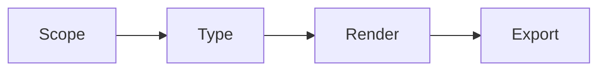
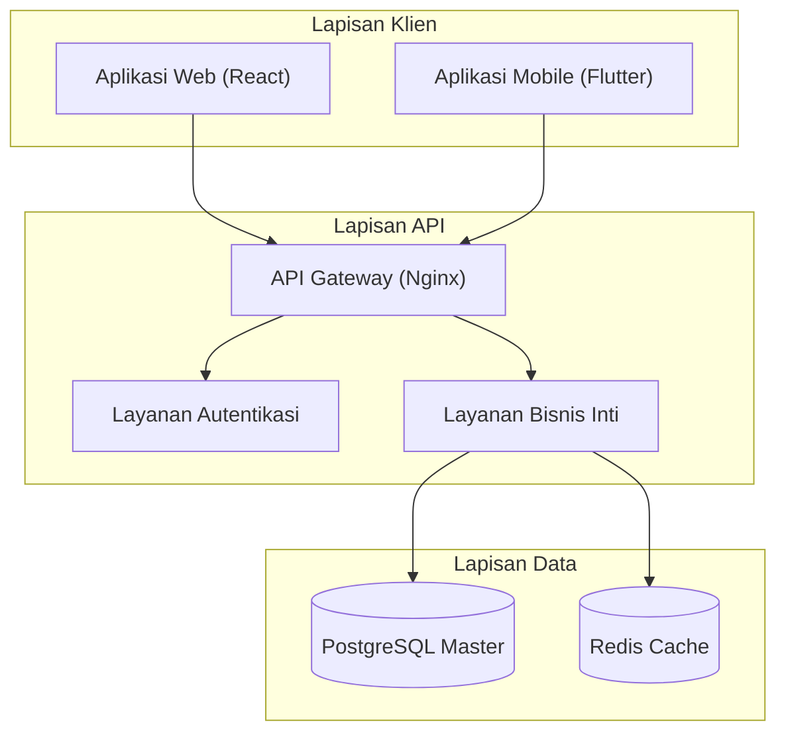
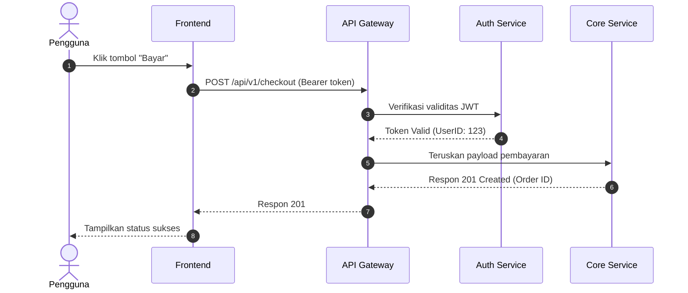
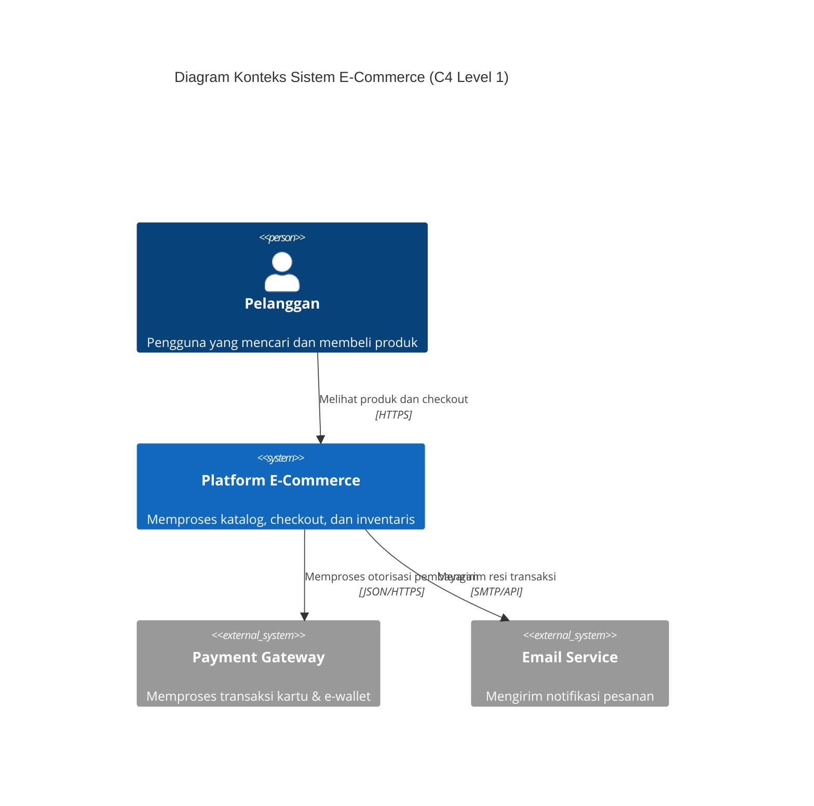
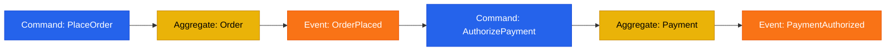

# Maxilun Diagrams: System Visualization & Flow Mapping

Bertanggung jawab atas visualisasi sistem teknis: diagram arsitektur tingkat tinggi, alur kerja proses (*workflows*), siklus pertukaran pesan (*sequence diagrams*), pipa data (*data pipelines*), dan mesin status (*state machines*). Mendukung sintaksis Mermaid bawaan dan berkas SVG/HTML interaktif mandiri.

## Skill Contract

- **Owns**: Mermaid, SVG, and standalone architecture, sequence, data-flow, and state diagrams.
- **Does not own**: architecture decisions or implementation changes.
- **Inputs**: approved decisions, entities, flows, and audience needs.
- **Outputs**: readable diagrams with a declared scope and legend where needed.
- **Handoff**: request missing decisions from `maxilun-architect` and publish diagrams through `maxilun-docsmith` when documentation needs them.

<!-- CORE-RULES:START -->
## Core Rules (Selalu Aktif)

Berlaku pada setiap respons dan setiap perubahan kode. Tidak bisa di-override oleh instruksi lain.

1. **Focus** — Tugas multi-langkah: buka dengan `🎯 [FOKUS]` + `⚡ [TINDAKAN]`. Maksimal 3 subtask aktif. Tugas trivial: langsung jawab tanpa HUD.
2. **Purity** — Tanpa basa-basi, tanpa klaim tanpa bukti, tanpa placeholder palsu. Setiap elemen harus punya fungsi nyata. Komentar menjelaskan MENGAPA, bukan APA.
3. **Minimalist** — YAGNI → reuse yang ada → stdlib → platform native → satu baris. Hapus sebelum menambah. Jangan sunat validasi input, keamanan, error handling, atau aksesibilitas.
4. **Clarity** — Langsung ke inti. Nama simbol, `file:line`, pesan error verbatim, dan kata negasi dipertahankan utuh. Label kepastian: `[CONFIRMED]` `[INFERRED]` `[UNCERTAIN]` `[UNVERIFIED]`.

**Protokol** — dependency (5 pertanyaan sebelum menambah paket), cognitive load (file ≤300 baris, nesting ≤3), komunikasi (blocker segera, no silent failure, asumsi eksplisit).

Detail lengkap: `../maxilun/references/engines.md`.
<!-- CORE-RULES:END -->

## 1. Engine Overrides

Delta domain terhadap Core Rules di atas. Override diagrams:
- **Purity**: Node/garis = entitas nyata. Tolak komponen fiktif dekoratif. Satu set warna, satu ketebalan garis.
- **Minimalist**: Mermaid markdown atau HTML tunggal mandiri. Zero external dependencies.
- **Clarity**: Label edge wajib kata kerja aktif (`"POST /checkout"`, `"Kueri data user"`). Panah kosong = dilarang.

## Workflow


## 2. Lima Jenis Diagram Sistem

| Jenis Diagram | Kasus Penggunaan Ideal | Sintaksis Mermaid Utama |
|---|---|---|
| **Arsitektur Sistem** | Komponen layanan, database, antrean, dan batas jaringan | `flowchart TB` atau `flowchart LR` |
| **Alur Kerja (Workflow)** | Proses bisnis, tahapan CI/CD, alur persetujuan | `flowchart TD` dengan subgraf |
| **Sequence Diagram** | Interaksi bertahap antar-layanan, handshake API, lifecycle request | `sequenceDiagram` |
| **Alur Data (Data Flow)** | Pipa ETL/ELT, streaming event, transformasi data | `flowchart LR` dengan node data |
| **State Machine** | Status pesanan, siklus hidup dokumen, status tiket | `stateDiagram-v2` |

## 3. Template Sintaksis Mermaid Standar

### 1. Diagram Arsitektur


### 2. Diagram Sequence Interaksi API


### 3. Diagram Arsitektur C4 Model (C4Context)


### 4. Diagram Event Storming & Alur Domain


## 4. Validasi Sintaksis Mermaid & Kompatibilitas Rendering

Sebelum menyerahkan diagram, validasi aturan sintaksis berikut untuk mencegah broken rendering:
1. **Quote Khusus**: Label node yang mengandung kurung, kurung siku, atau titik koma wajib diapit tanda kutip dua: `Node["Label (Info Tambahan)"]`.
2. **Karakter Terlarang**: Hindari tag HTML mentah seperti `<br>` di dalam Mermaid sequence diagram; gunakan newline `\n`.
3. **Verifikasi CLI (Opsional)**: Jika `@mermaid-js/mermaid-cli` terinstall:
   ```bash
   mmdc -i diagram.mmd -o diagram.svg
   ```
   Jika `mmdc` tidak terpasang, verifikasi dengan copy-paste ke mermaid.live atau pastikan parser Markdown viewer tidak melempar syntax error.

## Companion Skills Awareness

`maxilun-diagrams` memvisualisasikan sistem teknis (arsitektur, workflow, sequence). Jalankan mandiri untuk diagram dari deskripsi atau sumber yang diberikan; pilih companion sesuai jenis pemeriksaan yang diperlukan:

| Companion | Diagrams' Role | Purity & Quality Contribution |
|---|---|---|
| `maxilun-architect` | Architecture correctness validation | Gunakan bila sumber atau batas arsitektur belum jelas |
| `maxilun-craft` | Visual clarity dan design consistency | Opsional untuk keterbacaan, aksesibilitas, atau konsistensi visual |

**Penggunaan companion**: Untuk diagram yang menyatakan fakta arsitektur, validasi sumber dan asumsi; libatkan `maxilun-architect` bila kebenaran atau batas sistem belum jelas. `maxilun-craft` opsional untuk keterbacaan dan konsistensi visual, dan tidak menggantikan pemeriksaan kebenaran arsitektur.

## Related Skills
- **maxilun-architect**: Validasi kebenaran arsitektur sebelum visualisasi
- **maxilun-craft**: Design tokens dan visual clarity untuk diagram yang konsisten
- **maxilun-docsmith**: Integrasi diagram ke dalam dokumentasi teknis

## 5. Dukungan Ekspor Mandiri (Standalone SVG/HTML & JSON Graph)

1. **Standalone Interaktif (HTML/SVG)**:
   Jika platform tidak merender Mermaid bawaan, hasilkan berkas `.html` tunggal mandiri yang menyematkan SVG inline, variabel tema gelap/terang, dan kapabilitas zoom/pan interaktif tanpa dependensi eksternal.
2. **Ekspor Spesifikasi JSON**:
   Jika dibutuhkan untuk integrasi dengan visualizer eksternal atau `maxilun-knowledge-graph` (Maxilun Lens), hasilkan representasi node dan edge dalam format JSON terstruktur secara mandiri.
