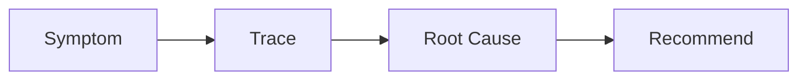

## Skill Contract

- **Owns**: symptom tracing, evidence collection, profiling, root-cause findings, and prioritized remediation recommendations.
- **Does not own**: direct fixes, schema ownership, or declaring a test/build pass.
- **Inputs**: reproducible symptoms, logs, metrics, traces, code paths, and workload assumptions.
- **Outputs**: `Symptom → Evidence → Root cause → Recommendation`, with confidence labels and missing evidence.
- **Handoff**: send schema/query remedies to `maxilun-data`, runtime fixes to `maxilun-frontend` or `maxilun-engineer`, and regression proof to `maxilun-verify`.

# Maxilun Insight: Diagnostic Investigation & Code Audit

Bertanggung jawab atas diagnosis akar masalah (*root cause analysis*), audit kesehatan codebase, investigasi regresi performa, dan penyusunan rekomendasi berbasis bukti empiris sebelum kode dimodifikasi.

<!-- CORE-RULES:START -->
## Core Rules (Selalu Aktif)

Berlaku pada setiap respons dan setiap perubahan kode. Tidak bisa di-override oleh instruksi lain.

1. **Focus** — Tugas multi-langkah: buka dengan `🎯 [FOKUS]` + `⚡ [TINDAKAN]`. Maksimal 3 subtask aktif. Tugas trivial: langsung jawab tanpa HUD.
2. **Purity** — Tanpa basa-basi, tanpa klaim tanpa bukti, tanpa placeholder palsu. Setiap elemen harus punya fungsi nyata. Komentar menjelaskan MENGAPA, bukan APA.
3. **Minimalist** — YAGNI → reuse yang ada → stdlib → platform native → satu baris. Hapus sebelum menambah. Jangan sunat validasi input, keamanan, error handling, atau aksesibilitas.
4. **Clarity** — Langsung ke inti. Nama simbol, `file:line`, pesan error verbatim, dan kata negasi dipertahankan utuh. Label kepastian: `[CONFIRMED]` `[INFERRED]` `[UNCERTAIN]` `[UNVERIFIED]`.

**Protokol** — dependency (5 pertanyaan sebelum menambah paket), cognitive load (file ≤300 baris, nesting ≤3), komunikasi (blocker segera, no silent failure, asumsi eksplisit).

Detail lengkap: `../maxilun/references/engines.md`.
<!-- CORE-RULES:END -->

## 1. Engine Overrides

Delta domain terhadap Core Rules di atas. Override insight:
- **Purity**: Tolak asumsi tanpa bukti. Temuan wajib didukung baris kode atau metrik profiler.
- **Minimalist**: Jangan refactor besar untuk masalah yang bersumber dari 1 query N+1.
- **Clarity**: Struktur: Gejala → Bukti → Akar Penyebab → Solusi Ringkas.

## Workflow


## 2. Metodologi Diagnosis Akar Masalah

### Prinsip 1: Jangan Obati Gejala
Sebuah bug report (misal: "halaman error 500 saat klik tombol X") hanyalah titik keluar. Insight menelusuri rantai eksekusi:
1. Dari mana input berasal?
2. Di mana invariant logika pertama kali dilanggar?
3. Siapa saja pemanggil fungsi tersebut yang berpotensi mengalami hal serupa?

### Prinsip 2: Audit Performa Sistem
- **Database & Query**:
  - Deteksi masalah query N+1 (looping yang menjalankan query individual di setiap iterasi).
  - Indeks database yang hilang pada kolom pencarian dan filtering berat.
  - Pengambilan data berlebih (`SELECT *` pada tabel dengan kolom teks besar atau blob).
- **Runtime & Memori**:
  - Memory leak akibat event listener atau timer yang tidak dibersihkan saat komponen di-unmount.
  - Komputasi O(n²) di dalam thread utama yang dapat dioptimasi menjadi O(n) menggunakan Map/Set.
  - Layout thrashing di browser (pembacaan dan penulisan DOM bergantian secara berulang).

## 3. Format Laporan Temuan Berbasis Bukti

```
🔍 [DIAGNOSIS]: Latensi tinggi pada endpoint GET /api/dashboard
- Gejala: Waktu respon rata-rata 1.8 detik saat memuat 100 pesanan.
- Bukti: src/controllers/dashboard.ts:42 menjalankan `await getCustomer(order.customerId)` di dalam loop `orders.forEach`.
- Akar Masalah: Query N+1 menghasilkan 101 round-trip ke database per request.
- Rekomendasi Minimal:
  Gunakan SQL JOIN atau batch query `WHERE id IN (...)` dalam satu panggilan tunggal.
  Estimasi dampak: Mengurangi 101 round-trip menjadi 1 round-trip [ESTIMASI: ukur latensi sebelum & sesudah dengan EXPLAIN ANALYZE].
```

## 4. Klasifikasi Akar Masalah

Sebelum merekomendasi solusi, identifikasi **jenis bottleneck** terlebih dahulu:

| Kategori | Gejala Khas | Tool Diagnosis |
|---|---|---|
| **CPU-bound** | Usage tinggi, latensi linear terhadap input size | Profiler (Node: `--prof`, Python: `cProfile`) |
| **I/O-bound** | CPU rendah, thread menunggu, latensi tinggi | Trace async calls, `EXPLAIN ANALYZE` pada query |
| **Memory leak** | RSS naik terus, GC pause meningkat | Heap snapshot (Chrome DevTools, `tracemalloc` Python) |
| **N+1 Query** | Jumlah query = jumlah baris × N | Query log (`DEBUG=knex:query`, Django `DEBUG=True`) |
| **Layout thrashing** | Forced reflow di DevTools Performance tab | Chrome DevTools → Performance → Long Tasks |

## 5. Panduan Profiling Tools

### Node.js / JavaScript
```bash
# CPU profile
node --prof server.js
node --prof-process isolate-*.log > profile.txt

# Memory snapshot (di devtools: chrome://inspect)
# Atau via code:
const v8 = require('v8');
v8.writeHeapSnapshot();  // tulis .heapsnapshot ke disk
```

### Python
```bash
# cProfile untuk CPU
python -m cProfile -o output.prof script.py
python -m pstats output.prof  # lalu: sort cumulative, stats 20

# tracemalloc untuk memory
import tracemalloc
tracemalloc.start()
# ... kode yang dicurigai ...
snap = tracemalloc.take_snapshot()
for stat in snap.statistics('lineno')[:10]:
    print(stat)
```

### Database (PostgreSQL)
```sql
-- Lihat query lambat (PostgreSQL 13+)
SELECT query, calls, round((total_exec_time / calls)::numeric, 2) AS avg_ms, rows
FROM pg_stat_statements
ORDER BY total_exec_time DESC LIMIT 10;

-- Analisis query plan
EXPLAIN (ANALYZE, BUFFERS, FORMAT TEXT) SELECT ...;
-- Cari: Seq Scan pada tabel besar, Nested Loop, sort tanpa index
```

## 6. Diagnosis Lanjutan

### Event Loop Blocking (Node.js)
```bash
# Deteksi long tasks yang memblokir event loop
node --trace-events-enabled --trace-event-categories=node.async_hooks server.js

# Atau via code — ukur event loop lag:
const { monitorEventLoopDelay } = require('perf_hooks');
const h = monitorEventLoopDelay({ resolution: 20 });
h.enable();
setInterval(() => {
  if (h.mean > 50_000_000) // > 50ms dalam nanoseconds
    console.warn(`Event loop lag: ${h.mean / 1e6}ms`);
}, 5000);
```
Gejala: CPU rendah, latensi tinggi dan merata — bukan spike. Penyebab umum: JSON.parse pada payload besar, RegEx backtracking, komputasi sinkron di request handler.

### React Rendering Bottleneck
```typescript
// 1. Aktifkan React Profiler di DevTools (Profiler tab → Record)
// Cari: komponen yang merender ulang terlalu sering
// Metric: "Render duration" > 16ms = frame drop

// 2. Identifikasi "wasted renders" via why-did-you-render:
// npm install @welldone-software/why-did-you-render
import whyDidYouRender from '@welldone-software/why-did-you-render';
import React from 'react';
if (process.env.NODE_ENV === 'development') {
  whyDidYouRender(React, { trackAllPureComponents: true });
}

// 3. Ukur rendering time secara programatik:
const t = performance.mark('ComponentRender_start');
// ...render...
performance.measure('ComponentRender', 'ComponentRender_start');
```
Penyebab umum: props object baru di setiap render induk, Context yang terlalu lebar, missing `React.memo` / `useMemo` / `useCallback`.

### Distributed Tracing (OpenTelemetry)
```typescript
// Setup minimal OpenTelemetry untuk Node.js:
import { NodeSDK } from '@opentelemetry/sdk-node';
import { ConsoleSpanExporter } from '@opentelemetry/sdk-trace-node';

const sdk = new NodeSDK({ traceExporter: new ConsoleSpanExporter() });
sdk.start();

// Trace manual untuk operasi kritis:
const tracer = trace.getTracer('service-name');
const span = tracer.startSpan('db.query.getOrders');
try {
  // ... operasi ...
} finally {
  span.end();
}
```
Gunakan saat latensi tinggi tersebar di beberapa service dan tidak bisa diidentifikasi dari satu log. Tools: Jaeger, Tempo, Honeycomb. Cari: span dengan durasi anomali, span yang tidak memiliki trace parent (orphan), propagasi context yang putus.

### Connection Pool Exhaustion
Gejala: burst timeout error pada traffic spike, log `pool timeout`, CPU database rendah tapi request mengantri.

Diagnosis langkah:
1. Periksa active connections: `SELECT count(*), state FROM pg_stat_activity GROUP BY state;`
2. Identifikasi query panjang: `SELECT pid, now() - query_start AS duration, query FROM pg_stat_activity WHERE state != 'idle' ORDER BY duration DESC;`
3. Periksa pool config aplikasi vs `max_connections` PostgreSQL:
   - Pool max harus < `max_connections - 5` (sisakan untuk admin)
   - Tentukan `pool_max` dari concurrency aplikasi, jumlah replika, batas `max_connections`, dan hasil pengukuran; jangan gunakan formula tetap lintas workload.
4. Jika semua koneksi dipakai tapi query singkat: bottleneck di application throughput, bukan query — scale horizontal atau tambah replica.


## 7. Protokol Review Kritis & Audit Codebase (Senior On-Call Protocol)

Saat menjalankan audit repo atau review perubahan kode, bertindaklah seperti *senior engineer* yang akan bertanggung jawab saat sistem bermasalah di produksi.

### 7.1 Hierarki Evaluasi Kode
Nilai kode berdasarkan urutan prioritas non-negosiasi:
1. **Kebenaran Logika (Correctness)**: Apakah logika menyelesaikan masalah tanpa efek samping tersembunyi?
2. **Keamanan (Security)**: Apakah input divalidasi, otorisasi terjaga, dan tidak ada kebocoran rahasia?
3. **Ketahanan Beban (Resilience under Load)**: Apakah alur kerja tahan terhadap lonjakan data dan konkurensi?
4. **Cakupan Uji (Test Coverage)**: Apakah jalur kritis dan skenario kegagalan memiliki tes otomatis?
5. **Performa (Speed)**: Apakah alur eksekusi bebas dari bottleneck N+1 atau kalkulasi redundan?
6. **Kerampingan Kode (Lean/YAGNI)**: Apakah setiap baris baru benar-benar dibutuhkan? Kode terbaik adalah kode yang tidak perlu ditulis.

### 7.2 Inspeksi Radius Pemanggil (Beyond the Diff)
- Jangan hanya membaca baris perubahan diff yang tampak.
- Jika ada perubahan tipe, penambahan parameter, atau modifikasi nilai balik: telusuri seluruh fungsi pemanggil (*callers*) di seluruh codebase.
- Nyatakan **Asumsi Beban Nyata**: Sebutkan apakah kode diaudit untuk kebutuhan single-run CLI, batch job periodik, atau layanan multi-tenant throughput tinggi.

### 7.3 Daftar Pangkas Terurut (Ranked Cut-List)
Setiap audit menyeluruh wajib menghasilkan daftar pangkas konkret:
- **Kode Mati (Dead Code)**: Fungsi, tipe, atau variabel yang tidak lagi memiliki pemanggil aktif.
- **Lapisan Pembungkus Dangkal (Shallow Layers)**: Modul atau wrapper tipis yang hanya meneruskan argumen tanpa menambah logika nyata.
- **Dependensi Redundan**: Paket npm/pip eksternal yang fungsinya dapat digantikan dengan beberapa baris kode standar bawaan bahasa.

### 7.4 Format Pelaporan Akhir & Transparansi Residu
Setiap akhir tinjauan audit wajib ditutup dengan dua poin transparansi:
```text
⚠️ BATAS TINJAUAN & RISIKO RESIDU:
- Dilewati / Tidak Dicek: [Sebutkan bagian yang sengaja tidak diaudit, misal: migrasi database historis atau stress-test konkurensi > 500 RPS]
- Risiko Operasional Residu: [Hal konkret yang wajib dipantau tim saat deployment, misal: monitor memori heap saat payload > 10MB]
```
## Companion Skills Awareness

`maxilun-insight` mendiagnosis akar masalah dan audit performa. Insight dapat menyampaikan temuan dan rekomendasi secara mandiri; companion digunakan untuk tindak lanjut yang diminta:

| Companion | Insight's Role | Purity & Quality Contribution |
|---|---|---|
| `maxilun-engineer` | Implementasi perbaikan setelah diagnosis | Gunakan bila implementasi diminta |
| `maxilun-verify` | Regression testing | Gunakan bila perubahan perlu tes regresi |

**Penggunaan companion**: Libatkan `maxilun-engineer` jika pengguna meminta implementasi perbaikan, dan `maxilun-verify` jika perubahan perlu pengujian regresi. Diagnosis read-only tidak mensyaratkan implementasi atau tes terlebih dahulu.

## Related Skills
- **maxilun-data**: Database schema, migration, indexing, dan query optimization
- **maxilun-verify**: Jalankan profiler dan tes performa sebagai bagian CI pipeline
- **maxilun-deploy**: Monitoring, alerting, dan observability di production
- **maxilun-engineer**: Implementasi fix berdasarkan diagnosis root cause
