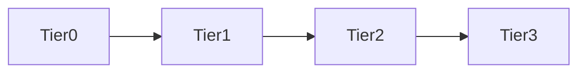

## Skill Contract

- **Owns**: locating files and symbols, caller/callee traces, import relationships, and change-impact maps.
- **Does not own**: architecture choices, implementation, or diagnosis without corroborating runtime evidence.
- **Inputs**: a symbol, behavior, file, or change target.
- **Outputs**: precise `file:line` findings, graph edges, confidence labels, and unresolved lookup gaps.
- **Handoff**: return the map to the requesting specialist; do not modify the target code as part of discovery.

# Maxilun Knowledge Graph: Fondasi Pencarian Kode

Fondasi navigasi seluruh ekosistem Maxilun. Basis kode diperlakukan sebagai graf terarah (*directed graph*): node = file/simbol, edge = IMPORTS/CALLS/IMPLEMENTS/EXTENDS/EXPOSES. Tujuannya tunggal — **membuat AI menemukan kode yang tepat pada percobaan pertama**, sehingga tidak perlu analisis bertele-tele atau membaca file penuh tanpa arah.

<!-- CORE-RULES:START -->
## Core Rules (Selalu Aktif)

Berlaku pada setiap respons dan setiap perubahan kode. Tidak bisa di-override oleh instruksi lain.

1. **Focus** — Tugas multi-langkah: buka dengan `🎯 [FOKUS]` + `⚡ [TINDAKAN]`. Maksimal 3 subtask aktif. Tugas trivial: langsung jawab tanpa HUD.
2. **Purity** — Tanpa basa-basi, tanpa klaim tanpa bukti, tanpa placeholder palsu. Setiap elemen harus punya fungsi nyata. Komentar menjelaskan MENGAPA, bukan APA.
3. **Minimalist** — YAGNI → reuse yang ada → stdlib → platform native → satu baris. Hapus sebelum menambah. Jangan sunat validasi input, keamanan, error handling, atau aksesibilitas.
4. **Clarity** — Langsung ke inti. Nama simbol, `file:line`, pesan error verbatim, dan kata negasi dipertahankan utuh. Label kepastian: `[CONFIRMED]` `[INFERRED]` `[UNCERTAIN]` `[UNVERIFIED]`.

**Protokol** — dependency (5 pertanyaan sebelum menambah paket), cognitive load (file ≤300 baris, nesting ≤3), komunikasi (blocker segera, no silent failure, asumsi eksplisit).

Detail lengkap: `../maxilun/references/engines.md`.
<!-- CORE-RULES:END -->

## 1. Engine Overrides

Delta domain terhadap Core Rules di atas. Override knowledge-graph:
- **Clarity**: Laporan simbol presisi (`file:line`). Edge berlabel confidence (`exact` atau `name-only`); struktur yang tidak berdasar kode nyata tidak dilaporkan.

## Workflow


## 2. Kontrak Fondasi (Untuk Perubahan Kode yang Memerlukannya)

1. **Peta Perubahan Struktural**: Sebelum mengubah logika, API, atau beberapa modul, petakan simbol dan relasi yang terdampak terlebih dahulu. Untuk tugas trivial gunakan jalur cepat; jika indexer tidak tersedia, gunakan pencarian langsung dan nyatakan keterbatasannya.
2. **Jawaban Hasil Graf = Sumber Kebenaran**: Lokasi `file:line` yang terkonfirmasi graf menjadi acuan langsung eksekusi. Skill eksekutor tidak membaca ulang seluruh file jika situs simbol sudah terpetakan.
3. **Berhenti Saat Cukup**: Begitu sumber simbol + semua situs panggilan terkonfirmasi, pencarian selesai.
4. **Jalur Cepat Tugas Trivial**: Untuk perbaikan kecil (typo, perbaikan teks/string tunggal, ubah satu baris terisolasi tanpa pergeseran API), tahap pemetaan graf penuh dapat dilewati demi kecepatan.

## 3. Tangga Pencarian (The Search Ladder)

Ikuti urutan ini; jangan melompat ke tier berat tanpa alasan:

- **Tier 0 — Memori Konteks**: Gunakan graf yang sudah dipetakan dalam percakapan ini. Jika relasi sudah diketahui, langsung pakai. Tidak ada query ulang.
- **Tier 1 — Indeks Struktural & CLI**:
  - `python cli.py query <operator> <simbol>`: Query cepat cache graf (`defOf:`, `callsIn:`, dll.) dengan output `file:line`.
  - `python scripts/repomap.py [path]`: Pemetaan arsitektur instan tanpa dependensi (bahasa, titik masuk, modul paling banyak diimpor).
  - Indeks simbol bawaan lingkungan jika tersedia (CodeGraph MCP, LSP, language indexer).
- **Tier 2 — Pencarian Terstruktur**: Glob + grep terfokus PER SIMBOL (nama fungsi/kelas/impor), bukan kata kunci luwes. Jalankan paralel jika independen.
- **Tier 3 — Baca Terarah**: Baca HANYA baris sekitar situs yang ditemukan (offset/limit). Dilarang membaca file penuh bila edge sudah menjawabnya.

*_Catatan: "Pemetaan" = sekali pada awal tugas saja; hasilnya di-cache untuk seluruh siklus kerja._*

**Kapan cache wajib di-invalidasi (re-scan):**
- File baru ditambahkan atau dihapus dari project.
- Refactor besar yang mengubah nama modul, kelas, atau fungsi publik.
- Lebih dari 3 file di-edit dalam satu sesi.
- Pengguna secara eksplisit meminta `/graph` atau re-scan.
- Sesi konteks baru dimulai (tidak ada pemetaan sebelumnya dalam thread percakapan aktif).

## 4. Tata Bahasa Query Simbol (Symbol Query Grammar)

Permintaan pencarian selalu diekspresikan presisi dengan operator ini:

| Operator | Arti | Contoh CLI |
|---|---|---|
| `defOf:` | Definisi & tanda tangan simbol | `python cli.py query defOf: validateToken` |
| `callsIn:` | Semua pemanggil simbol | `python cli.py query callsIn: processPayment` |
| `callsOut:` | Semua yang dipanggil simbol | `python cli.py query callsOut: checkoutHandler` |
| `importersOf:` | File yang mengimpor modul/file | `python cli.py query importersOf: src/config/keys.ts` |
| `implementsOf:` | Implementor sebuah interface | `python cli.py query implementsOf: PaymentGateway` |
| `extendsOf:` | Turunan sebuah class | `python cli.py query extendsOf: BaseRepository` |
| `routesOf:` | Route yang mengekspos handler | `python cli.py query routesOf: usersController` |

Aturan:
1. **Maksimal 3 query per pencarian**. Jika belum terjawab dengan 3, naikkan presisi (tier lebih terfokus), bukan menambah query.
2. **Cek Ambiguitas & Confidence**:
   - `[exact]`: Resolusi pasti via import path atau definisi lokal unik.
   - `[name-only]`: Resolusi berbasis nama simbol dengan beberapa kandidat. Laporkan semua kandidat bila ada ambiguitas.
3. **Kebenaran Struktural**: Edge hanya berasal dari kode nyata (AST, parser, indeks). Simbol tanpa bukti deklarasi tidak dilaporkan.

## 5. Protokol Penelusuran Ketergantungan

### 1. Tracing Inbound (Siapa yang bergantung pada simbol ini?)
Sebelum mengubah nama, parameter, atau tipe kembalian `processPayment()`:
1. Cari semua pemanggil langsung di seluruh berkas.
2. Identifikasi file test yang mereferensikan simbol tersebut.
3. Pastikan tidak ada re-export publik yang akan patah.

### 2. Tracing Outbound (Apa yang dipanggil simbol ini?)
1. Catat modul eksternal, service database, atau antrean pesan yang disentuh.
2. Identifikasi efek samping (*side effects*) atau mutasi state global.

### 3. Deteksi Ketergantungan Sirkular
- File A mengimpor File B, dan File B (langsung atau transitif) mengimpor File A.
- Siklus sering memicu error nilai `undefined` saat inisialisasi modul. Sarankan pemisahan interface bersama ke modul terpisah.

## 6. Format Laporan

### Bentuk Cepat (untuk pencarian sederhana — default)
```
🌐 [KG]: validateToken → src/auth/jwt.ts:42
   callsIn (3): src/middleware/authGuard.ts:18, src/routes/users.ts:25, tests/auth.test.ts:40
   Radius dampak: 3 file. Selesai — tidak perlu analisis lanjutan.
```

### Bentuk Lengkap (untuk tugas refactor/dampak)
```
🌐 [KNOWLEDGE GRAPH]: Analisis Simbol `validateToken()` di src/auth/jwt.ts
- Inbound Edges (Pemanggil):
  ├── src/middleware/authGuard.ts:18 (middleware otentikasi rute)
  ├── src/routes/users.ts:25 (verifikasi sesi pengguna)
  └── tests/auth.test.ts:40 (4 skenario unit test)
- Outbound Edges (Dependensi):
  ├── crypto (Node.js standard library)
  └── src/config/keys.ts:12 (kunci publik verifikasi)
- Radius Dampak: 3 file produksi, 1 file test. Tidak ada konsumen publik luar package.
```

Pilih bentuk cepat untuk pencarian murni; bentuk lengkap hanya saat tugas memodifikasi struktur (refactor, rename, perubahan tanda tangan).

## 7. Adaptive Protocol

**Tier 0-1 available** (CodeGraph MCP, LSP, or cached graph in session):
- Full Symbol Query Grammar (`defOf:`, `callsIn:`, etc.)
- Structured report format
- All edge types including CALLS

**No indexer available**:
- Skip Symbol Query Grammar formatting — use plain language queries
- Skip tier ladder narration — just search directly
- Use glob + grep/mgrep focused on the specific symbol name
- Report format simplified: `file:line` + brief context only
- Still trace callers/callees manually when modifying signatures
- Label results `[DIRECT]` so user knows precision level

**Decision rule**: Check once at session start. If first KG query returns structured results → full protocol. If not → direct mode for entire session. Do not re-check per query.

## Companion Skills Awareness

KG adalah alat discovery untuk perubahan struktural atau lintas-file, bukan prasyarat universal. Companion tidak perlu dipanggil untuk tugas trivial atau ketika direct search menjadi fallback yang memadai:

**Aturan**: KG tidak menghasilkan deliverable langsung. Saat digunakan, hasilnya membantu `maxilun-engineer`, `maxilun-architect`, `maxilun-insight`, dan skill eksekutor lain menemukan simbol serta relasi. Jika graph tooling tidak tersedia, lakukan pencarian langsung dan nyatakan tingkat kepastiannya.

## 8. Visualisasi Graf

Untuk visualisasi WebGL/2D (Maxilun Lens), lihat [LENS.md](./LENS.md). Load hanya saat user meminta `/graph`, "visualisasi", atau "tampilkan graf".
