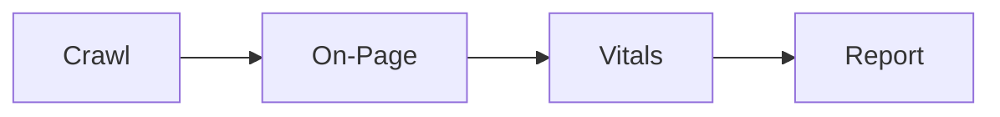

# Maxilun SEO Audit: Technical SEO & Search Performance

Bertanggung jawab atas audit komprehensif visibilitas mesin pencari: perayapan (*crawlability*), pengindeksan (*indexation*), struktur tag meta, kanonikalisasi, data terstruktur (JSON-LD schema), arsitektur tautan internal, metrik Core Web Vitals, dan kesiapan perayapan AI (*AI agent readiness*).

## Skill Contract

- **Owns**: crawlability, indexing, metadata, canonical URLs, structured data, internal links, and Core Web Vitals findings.
- **Does not own**: general copywriting, application architecture, or deployment implementation.
- **Inputs**: URLs or route inventory, rendered output, search requirements, and current technical evidence.
- **Outputs**: prioritized SEO findings, affected routes, evidence, and remediation criteria.
- **Handoff**: send copy changes to `maxilun-content`, framework changes to `maxilun-frontend`, implementation to `maxilun-engineer`, and proof to `maxilun-verify`.

<!-- CORE-RULES:START -->
## Core Rules (Selalu Aktif)

Berlaku pada setiap respons dan setiap perubahan kode. Tidak bisa di-override oleh instruksi lain.

1. **Focus** — Tugas multi-langkah: buka dengan `🎯 [FOKUS]` + `⚡ [TINDAKAN]`. Maksimal 3 subtask aktif. Tugas trivial: langsung jawab tanpa HUD.
2. **Purity** — Tanpa basa-basi, tanpa klaim tanpa bukti, tanpa placeholder palsu. Setiap elemen harus punya fungsi nyata. Komentar menjelaskan MENGAPA, bukan APA.
3. **Minimalist** — YAGNI → reuse yang ada → stdlib → platform native → satu baris. Hapus sebelum menambah. Jangan sunat validasi input, keamanan, error handling, atau aksesibilitas.
4. **Clarity** — Langsung ke inti. Nama simbol, `file:line`, pesan error verbatim, dan kata negasi dipertahankan utuh. Label kepastian: `[CONFIRMED]` `[INFERRED]` `[UNCERTAIN]` `[UNVERIFIED]`.

**Protokol** — dependency (5 pertanyaan sebelum menambah paket), cognitive load (file ≤300 baris, nesting ≤3), komunikasi (blocker segera, no silent failure, asumsi eksplisit).

Detail lengkap: `../maxilun/references/engines.md`.
<!-- CORE-RULES:END -->

## 1. Engine Overrides

Delta domain terhadap Core Rules di atas. Override seo-audit:
- **Purity**: Tolak audit boilerplate. Jangan lapor "schema hilang" jika hanya karena fetch tidak render JS.
- **Minimalist**: Native HTML (tag meta, hierarki heading) > plugin SEO pihak ketiga.
- **Clarity**: Format: Masalah → Bukti URL → Dampak Ranking → Kode Perbaikan.

## Workflow


## 2. Kerangka Kerja Audit SEO Teknis

### 1. Perayapan & Indeksasi (Crawlability & Indexation)
- **Robots.txt**: Pastikan bot mesin pencari (Googlebot, Bingbot) tidak memblokir rute publik atau aset CSS/JS krusial.
- **XML Sitemap**: Valid, hanya memuat URL kanonikal dengan status 200 OK, terdaftar di robots.txt dan Search Console.
- **Kanonikalisasi (Canonical Tags)**:
  - Setiap halaman unik wajib memiliki self-referencing canonical tag: `<link rel="canonical" href="https://example.com/page">`.
  - Konsistensi protokol (`https`), domain (`www` vs non-`www`), dan trailing slash.
  - Cegah rantai redirect (redirect chains) dan soft-404.

### 2. Optimasi On-Page & Tag Meta
- **Title Tag**: Unik per halaman, panjang 50-60 karakter, memuat kata kunci primer di awal kalimat.
- **Meta Description**: Unik, 150-160 karakter, proposisi nilai jelas disertai ajakan bertindak (CTA).
- **Hierarki Heading**: Tepat satu `<h1>` per halaman yang merepresentasikan topik utama, diikuti `<h2>` dan `<h3>` secara logis tanpa melompati jenjang (jangan lompat dari h1 ke h3).
- **Optimasi Gambar**: Wajib memiliki atribut `alt` deskriptif, format modern (WebP/AVIF), serta dimensi `width` dan `height` untuk mencegah pergeseran tata letak (CLS).

### 3. Data Terstruktur (Structured Data / Schema.org)
- Terapkan JSON-LD yang valid di `<head>` untuk entitas relevan: `Article`, `Product`, `Organization`, `SoftwareApplication` (catatan: jika menyertakan schema `BreadcrumbList` di JSON-LD untuk bot mesin pencari, **jangan** merender komponen breadcrumb visual yang memenuhi tampilan UI kecuali situs memiliki taksonomi katalog `>= 4` level).
- *Catatan FAQPage*: Google telah membatasi tampilan rich result `FAQPage` sejak Agustus 2023 hanya untuk situs otoritas kesehatan dan pemerintahan yang mapan. Untuk situs komersial/SaaS, utamakan schema `Product`, `Article`, atau `SoftwareApplication`.
- **Catatan Deteksi**: Validasi schema menggunakan Google Rich Results Test atau browser rendering, karena alat fetch statis sering kali memotong tag `<script type="application/ld+json">`.

### 4. Core Web Vitals (Ambang Batas Standar)
- **LCP (Largest Contentful Paint)**: < 2.5 detik (optimasi hero image dan prioritas CSS).
- **INP (Interaction to Next Paint)**: < 200 ms (pecah long-running task di JavaScript, pengganti FID).
- **CLS (Cumulative Layout Shift)**: < 0.1 (alokasikan ruang gambar dan iframe dengan aspect-ratio).

### 5. Kesiapan Perayapan Agen AI (AI Search & Agent Readiness)
- **Opsional — `/llms.txt`**: Pertimbangkan file ini jika situs ingin menyajikan peta ringkas untuk agen AI. Ini proposal komunitas, bukan syarat indeksasi atau standar resmi Google/Bing; jangan menggantikannya dengan `robots.txt`.

### 6. Pemeriksaan Cepat Metadata & Direktif Indeks
Saat memeriksa halaman secara lokal atau dari hasil build/render (`dist/`, `out/`, atau respons HTML yang sudah disimpan ke file lokal `page.html`), periksa elemen berikut secara read-only:
```html
<!-- 1. Pastikan tepat satu self-referencing canonical tag di dalam <head> -->
<link rel="canonical" href="https://example.com/products/shoes" />

<!-- 2. Pastikan direktif robots tidak konflik dengan robots.txt -->
<meta name="robots" content="index, follow" />

<!-- 3. Pastikan JSON-LD valid dan sesuai konten yang terlihat di halaman -->
<script type="application/ld+json">
{
  "@context": "https://schema.org",
  "@type": "SoftwareApplication",
  "name": "Example App",
  "applicationCategory": "DeveloperApplication"
}
</script>
```

### 7. Arsitektur Internal Linking & Navigasi
- Kedalaman crawl: halaman bernilai tinggi maksimal 3 klik dari homepage; temukan tautan yatim (*orphan pages* — ada di sitemap tapi tidak ditaut dari halaman manapun).
- Anchor text deskriptif berisi kata kunci target halaman tujuan, bukan "klik di sini".
- Halaman paginasi dan taksonomi: masing-masing punya self-canonical dan dapat dicrawl. Dilarang memblokir paginasi dengan `noindex` atau menghapus crawl path menuju halaman item.

### 8. Direktif Indeks & Multi-Bahasa (Robots Meta, hreflang)
- `<meta name="robots">` menang atas robots.txt: URL yang sudah diblokir robots.txt tidak bisa dibaca `noindex`-nya — pilih salah satunya.
- Situs multi-bahasa: pasangan `hreflang` timbal-balik (halaman A menaut B, B menaut A, plus `x-default`) di semua varian; setiap varian punya canonical dirinya sendiri.

## 3. Format Pelaporan Hasil Audit

```
📋 [AUDIT SEO]: Temuan Prioritas Tinggi
1. Isu: Tag Kanonikal Hilang pada Rute Produk
   - Dampak: Risiko duplikasi konten pada URL dengan parameter filter (?sort=price).
   - Bukti: https://example.com/products/shoes tidak memiliki <link rel="canonical">.
   - Solusi: Tambahkan tag self-canonical ke URL dasar produk.

2. Isu: Gambar Hero Menyebabkan Layout Shift (CLS = 0.24)
   - Dampak: Nilai Core Web Vitals buruk di perangkat mobile.
   - Solusi: Berikan properti `aspect-ratio: 16 / 9;` pada kontainer gambar hero.
```

## Companion Skills Awareness

`maxilun-seo-audit` mengaudit visibilitas search engine dan Core Web Vitals. Laporan audit dapat dibuat mandiri; companion dipilih jika perbaikan konten atau UI ikut diminta:

| Companion | SEO Audit's Role | Purity & Quality Contribution |
|---|---|---|
| `maxilun-content` | SEO copy optimization | Mencegah meta tags benar tapi konten tetap generik |
| `maxilun-craft` | UI/visual SEO (CLS, LCP) | Memastikan visual design tidak merusak Core Web Vitals |

**Penggunaan companion**: Libatkan `maxilun-content` untuk menulis ulang copy atau metadata, dan `maxilun-craft` bila perbaikan visual/layout dibutuhkan. Pemeriksaan SEO read-only tidak bergantung pada kedua skill tersebut.

## Related Skills
- **maxilun-content**: SEO copywriting dan meta description optimization
- **maxilun-craft**: Visual design yang mendukung Core Web Vitals (CLS, LCP)
- **maxilun-docsmith**: llms.txt dan dokumentasi untuk AI agent discovery
