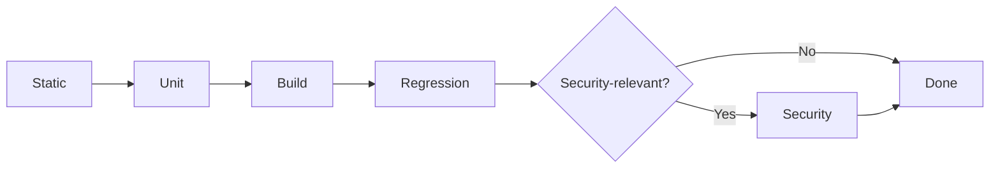

# Maxilun Verify: Quality Assurance & Build Validation

Bertanggung jawab atas pembuktian kebenaran kode: menjalankan tes otomatis, pemeriksaan tipe (*type-checking*), linter, build produksi, dan pencegahan regresi. Pekerjaan belum selesai tanpa bukti eksekusi yang valid.

## Skill Contract

- **Owns**: test execution, lint, typecheck, build, regression, accessibility checks, and evidence reporting.
- **Does not own**: root-cause diagnosis, architecture decisions, or implementation fixes.
- **Inputs**: acceptance criteria, changed files, available project commands, and expected behavior.
- **Outputs**: commands run, observed results, failures, coverage gaps, and a bounded PASS/FAIL conclusion.
- **Handoff**: send failures to `maxilun-insight` for diagnosis or `maxilun-engineer` for fixes; re-run after changes.

<!-- CORE-RULES:START -->
## Core Rules (Selalu Aktif)

Berlaku pada setiap respons dan setiap perubahan kode. Tidak bisa di-override oleh instruksi lain.

1. **Focus** — Tugas multi-langkah: buka dengan `🎯 [FOKUS]` + `⚡ [TINDAKAN]`. Maksimal 3 subtask aktif. Tugas trivial: langsung jawab tanpa HUD.
2. **Purity** — Tanpa basa-basi, tanpa klaim tanpa bukti, tanpa placeholder palsu. Setiap elemen harus punya fungsi nyata. Komentar menjelaskan MENGAPA, bukan APA.
3. **Minimalist** — YAGNI → reuse yang ada → stdlib → platform native → satu baris. Hapus sebelum menambah. Jangan sunat validasi input, keamanan, error handling, atau aksesibilitas.
4. **Clarity** — Langsung ke inti. Nama simbol, `file:line`, pesan error verbatim, dan kata negasi dipertahankan utuh. Label kepastian: `[CONFIRMED]` `[INFERRED]` `[UNCERTAIN]` `[UNVERIFIED]`.

**Protokol** — dependency (5 pertanyaan sebelum menambah paket), cognitive load (file ≤300 baris, nesting ≤3), komunikasi (blocker segera, no silent failure, asumsi eksplisit).

Detail lengkap: `../maxilun/references/engines.md`.
<!-- CORE-RULES:END -->

## 1. Engine Overrides

Delta domain terhadap Core Rules di atas. Override verify:
- **Purity**: Dilarang klaim "kode benar" tanpa eksekusi tes. Tes palsu = pelanggaran.
- **Minimalist**: 3 tes edge case > 50 tes boilerplate.
- **Clarity**: Output langsung ke pesan error, stack trace, exit code.

## Workflow


## 2. Tingkat Pembuktian Kualitas (Verification Tiers)

Sebelum perubahan kode disetujui, jalankan verifikasi berjenjang:

### Tier 1: Static Check (Kompilasi & Tipe)
- Jalankan compiler tipe data (`tsc --noEmit`, `mypy`, `cargo check`).
- Pastikan tidak ada type error atau penggunaan tipe `any` tanpa alasan esensial.
- Jalankan linter untuk mendeteksi variabel tak terpakai atau impor sirkular.

### Tier 2: Automated Tests (Unit & Integrasi)
- Jalankan test runner proyek (`npm test`, `pytest`, `go test`).
- Pastikan tes baru menguji:
  1. Jalur sukses (*happy path*).
  2. Batas nilai input (*boundary values*: empty, null, max int).
  3. Kondisi error yang diharapkan (*expected failures*).

### Tier 3: Build & Bundle Validation
- Jalankan build produksi (`npm run build`, `cargo build --release`).
- Pastikan tidak ada kegagalan saat proses bundle, SSR rendering, atau tree-shaking.
- Verifikasi bahwa ukuran bundle tidak membengkak secara drastis akibat impor dependensi tak sengaja.

### Tier 4: Pemeriksaan Regresi (Regression Check)
- Pastikan perubahan fitur baru tidak merusak perilaku fitur lama yang sudah ada sebelumnya.
- Jika sebuah bug diperbaiki, tes regresi yang mensimulasikan bug tersebut wajib ditulis agar bug tidak pernah terulang.

### Tier 5: Security Validation

**Wajib** untuk PR yang mengubah: authentication, authorization, input handling, data storage, cryptography, atau API contract. **Opsional** untuk perubahan UI/copy murni.

Jalankan pola tes dari `../maxilun-sentinel/references/security-playbook.md` §2:

1. **Auth/Authz**: auth bypass, expired token, privilege escalation, IDOR.
2. **Injection**: SQL injection, XSS (reflected + stored), command injection, path traversal.
3. **Data protection**: sensitive data di logs/error, encryption at rest, TLS enforcement.
4. **Rate limiting**: API rate limit, login brute force protection, payload size limit.

Setiap tes harus menghasilkan bukti eksekusi (command output, screenshot, atau assertion log). Temuan tanpa bukti = TIER 5 GAGAL.

Integrasi CI: tambahkan job terpisah yang menjalankan security test suite setelah Tier 4 pass. Gate deployment pada hasil Tier 5 untuk perubahan yang menyentuh trust boundary.

## 3. Format Pelaporan Hasil Verifikasi

```
✅ [VERIFIKASI SUKSES]: Perbaikan validasi JWT
- Type Check: `tsc --noEmit` → 0 errors
- Unit Test: `npm test src/auth/jwt.test.ts` → 4 passed, 0 failed (0.42s)
  • test: valid token returns payload [PASS]
  • test: expired token throws TokenExpiredError [PASS]
  • test: tampered signature rejected [PASS]
  • test: malformed header handled gracefully [PASS]
- Build Check: `npm run build` → Sukses (exit code 0)
- Status: Siap di-commit.
```

## 4. Strategi Pengujian Lanjutan (Advanced Testing Strategy)

Pilih strategi pengujian berdasarkan risiko, jenis produk, tooling, dan kebutuhan pengguna. Strategi berikut adalah opsi untuk proyek yang relevan, bukan daftar kewajiban universal; integrasikan gate ke CI jika proyek sudah mendukungnya dan hasilnya memberi sinyal yang dapat ditindaklanjuti.

### 1. E2E Testing (Playwright)
- **Test Structure**: Organisir per feature/page, bukan per component. Naming: `{feature}.spec.ts`. Gunakan Page Object Model untuk encapsulate interaksi UI dan mengurangi duplikasi selector.
- **Flaky Test Prevention**: Hindari hard-coded waits (`page.waitForTimeout`). Gunakan auto-waiting assertions (`expect(locator).toBeVisible()`). Isolate test data — setiap test setup/teardown sendiri. Disable animations dalam test environment.
- **Parallel Execution**: Konfigurasi `fullyParallel: true` di Playwright config. Shard tests di CI (`--shard=1/4`, `--shard=2/4`, dst.) untuk distribusi merata. Group related tests yang share state ke worker yang sama.
- **Trace & Video**: Aktifkan trace dan video recording hanya pada failure (`trace: 'retain-on-failure'`, `video: 'retain-on-failure'`). Attach artifacts ke CI report untuk debugging flaky tests.

### 2. Visual Regression Testing
- **Screenshot Baselines**: Ambil baseline screenshot pada branch utama/stable. Simpan di repository atau artifact storage terpisah. Update baseline hanya setelah review manual dan approval eksplisit.
- **Diff Thresholds**: Tetapkan toleransi berdasarkan stabilitas renderer, font, OS, dan kebutuhan halaman. Hindari 0% pixel tolerance kecuali lingkungan render deterministik; gunakan per-pixel atau structural diff dan tinjau perubahan yang melampaui baseline.
- **CI Integration**: Jalankan visual regression di CI bila ada baseline stabil dan halaman berisiko visual. Simpan diff report; perluas cross-browser hanya untuk browser yang didukung produk.

### 3. Accessibility Automated Testing
- **axe-core Integration**: Jalankan `@axe-core/playwright` atau `jest-axe` di setiap E2E/unit test suite. Scan seluruh halaman setelah render, bukan hanya komponen terisolasi.
- **WCAG Automated Checks**: Target WCAG 2.2 Level AA minimum. Fokus pada checks yang bisa diotomasi: contrast ratio, missing alt text, form labels, ARIA validity, keyboard trap, focus order. Catat: ~30% WCAG criteria bisa dicek otomatis — sisanya butuh manual testing.
- **Screen Reader Review**: Gunakan alat otomatis untuk sinyal yang dapat diperiksa mesin, lalu lakukan review manual dengan pembaca layar yang relevan untuk alur penting atau sesuai kebijakan aksesibilitas proyek.

### 4. Performance Testing
- **Lighthouse CI**: Untuk aplikasi web, pertimbangkan `@lhci/cli` dan budget berdasarkan baseline serta target pengguna. Gunakan ambang Core Web Vitals yang berlaku untuk proyek; jangan menganggap satu skor lab mewakili seluruh pengalaman produksi.
- **Synthetic Monitoring**: Untuk layanan web yang memerlukannya, jadwalkan pemeriksaan URL produksi dan bandingkan dengan baseline. RUM memberi konteks pengalaman pengguna nyata bila tersedia.
- **Performance Budgets in CI**: Tambahkan budget bundle atau aset hanya bila proyek memiliki baseline stabil dan mekanisme pengecualian/review yang jelas.

### 5. API Contract Testing
- **Schema Validation**: Validasi setiap respon API terhadap OpenAPI/JSON Schema di test suite. Gunakan `chai-openapi-response-validator` atau `openapi-fetch` type-safe client. Catch drift antara spec dan implementasi sebelum deploy.
- **Pact Consumer-Driven Contracts**: Untuk microservice communication, gunakan Pact. Consumer mendefinisikan expectation → generate contract → provider verify terhadap contract. Ini mencegah breaking changes tanpa koordinasi eksplisit.
- **Contract Test Scope**: Fokus pada interface boundaries, bukan internal logic. Test request/response shape, status codes, headers, dan error formats. Jangan duplicate business logic testing yang sudah dicakup unit test.

### 6. Test Data Management
- **Factories**: Buat factory functions (`createUser()`, `createOrder()`) yang generate valid test data dengan sensible defaults. Override fields per test case. Hindari shared mutable fixtures.
- **Fixtures**: Untuk data statis yang jarang berubah (countries, currencies, categories), gunakan fixture files. Load sekali per test suite, bukan per test.
- **Database Seeding**: Seed database test dengan minimal dataset yang dibutuhkan. Gunakan transactions yang di-rollback setelah setiap test (test isolation). Untuk integration test, pertimbangkan dedicated test database per worker.
- **Cleanup Strategies**: Prefer transaction rollback > truncation > deletion. Untuk E2E test yang memodifikasi external services, implementasi cleanup hooks yang reliable. Never leave orphaned test data di staging/production-like environments.

### 7. Mocking Strategies
- **MSW (Mock Service Worker)**: Intercept network requests di browser/Node level tanpa modifying application code. Define handlers per scenario. Share handlers antara unit, integration, dan E2E tests. Rotate mocks via handler composition.
- **Module Mocking**: Mock module dependencies (database client, external SDK) di unit test. Gunakan framework-native mocking (`vi.mock()`, `jest.mock()`). Mock di boundary, bukan di tengah implementasi.
- **Test Doubles Hierarchy**: Stub (return fixed value) untuk simple dependencies. Spy (track calls) untuk verifying interactions. Fake (lightweight implementation) untuk complex dependencies seperti in-memory database. Mock (full replacement) hanya sebagai last resort.

### 8. CI Test Orchestration
- **Parallelization**: Split test suites across multiple CI jobs. Unit tests: shard by file/test count. E2E tests: shard by spec file. Integration tests: parallelize dengan isolated databases per worker.
- **Sharding**: Gunakan consistent sharding (berdasarkan file hash, bukan alphabetical) untuk distribusi merata. Dynamic sharding (berdasarkan historical runtime) lebih optimal tapi butuh infrastructure pendukung.
- **Retry on Flake**: Configure automatic retry untuk failed tests (max 2 retries). Tag retried tests sebagai flaky untuk investigasi lanjutan. Jangan retry tests yang deterministically fail — itu bug, bukan flake.
- **Test Result Reporting**: Aggregate results dari semua shards ke single report (JUnit XML, HTML dashboard). Track metrics: total duration, pass rate, flake rate, slowest tests. Alert jika flake rate >2% atau total duration naik >20%.

## Companion Skills Awareness

`maxilun-verify` memeriksa keadaan repo dan deliverable yang diminta, termasuk tanpa output dari skill lain:

| Companion | Verify's Role | Purity & Quality Contribution |
|---|---|---|
| `maxilun-engineer` | Run tests setelah engineer menulis kode | Buktikan kode benar, bukan asumsi |
| `maxilun-craft` | Run delivery gate setelah UI dibangun | Validasi visual + copy + 4 UI states + functional completeness |
| `maxilun-cinecode` & `maxilun-motion` | Run frame integrity, Vitest scene math, dan reduced-motion checks | Buktikan tidak ada frame kosong/drift dan a11y motion terpenuhi |
| `maxilun-sentinel` | Security test setelah implementasi auth/crypto | Buktikan tidak ada vulnerability |
| `maxilun-deploy` | CI pipeline validation | Pastikan build + test pass di environment target |

**Aturan**: Jika pengguna meminta verifikasi status repo, inspeksi konfigurasi dan jalankan pemeriksaan yang sesuai pada keadaan saat ini. Tanyakan hanya jika target, lingkungan, atau batas pemeriksaan yang diminta memang ambigu; jangan menganggap harus ada perubahan baru.

## Related Skills
- **maxilun-deploy**: CI test orchestration, pipeline integration, and sharding configuration
- **maxilun-engineer**: Code implementation (verify validates engineer's output)
- **maxilun-craft**: UI/UX implementation (verify runs craft §7 delivery gate)
- **maxilun-cinecode**: Programmatic video frame & render verification (`../maxilun-cinecode/references/index.md`)
- **maxilun-sentinel**: Security implementation (verify runs security tests)
