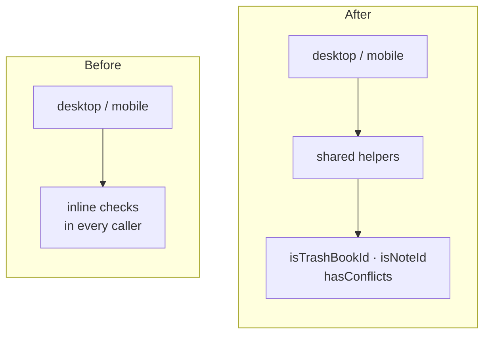

# Readable Mermaid Diagrams

A diagram is only useful if it reads at a glance. Mermaid picks the layout for
you, and its defaults are often wrong for the point you're making. A good layout
does as much for readability as the nodes do. Decide the layout on purpose, as
described below.

## How Inkdrop displays a diagram

- The preview pane is **narrow**. It's often half the window, or a phone screen.
- A diagram **scales down to fit the pane width** and is never scaled up.
  - Wide diagrams shrink, and their text becomes unreadable.
  - Tall diagrams keep full size. The reader just scrolls.
- So **width is the scarce resource**. Aim for about 3–4 nodes across at most.
- Readers can pan, zoom, and open full screen, but the default view should still
  be readable.

## Choose the diagram type first

| Content                                   | Diagram                 |
| ----------------------------------------- | ----------------------- |
| Who calls whom, in what order; races      | `sequenceDiagram`       |
| Lifecycle / modes and their transitions   | `stateDiagram-v2`       |
| Structure, dependencies, data flow        | `flowchart`             |
| Data model and relations                  | `erDiagram`             |
| Schedule / phases over time               | `gantt`                 |
| Before → after, option A vs B             | `flowchart` + subgraphs |

Write `flowchart` rather than `graph`. They're aliases, but `flowchart` gets the
newer features.

## Pick the direction from the shape

- **Long chain** (4+ steps in a row) → `TD`. A long `LR` chain overflows the
  width.
- **Short chain with many siblings** (fan-out) → `LR`, so the siblings stack
  vertically instead of spreading sideways.
- **Two or three parallel groups to compare** → `LR` at the top level, so the
  groups sit side by side, and `TB` inside each group.
- If the result is wider than it is tall and has more than about 4 columns,
  flip the direction.

## Subgraphs: always set `direction` explicitly

This catches people out. A subgraph whose nodes have **no edges to anything
outside it** is laid out as its own small graph. When the subgraph has no
`direction` line, **Mermaid rotates it 90° from the parent**. In a
`flowchart LR`, each isolated subgraph becomes top-down, and the reverse.

- Give every subgraph its own `direction TB` / `direction LR`.
- A subgraph's `direction` is **ignored** once any of its nodes link to a node
  outside it. The subgraph then follows the parent's direction.
- **Disconnected subgraphs stack along the cross axis in no guaranteed order**.
  For example, `After` can come out above `Before`. Chain them with an
  invisible link, `A ~~~ B`, to fix both their order and their placement.

Before/after comparison, side by side, each flowing top-down:

````markdown

````

- To stack the groups vertically and have each flow left to right instead, use
  `flowchart TB` with `direction LR` inside.
- Nodes at the same step are **centered** on each other across the layout. You
  can't align them to the top or bottom. If a short group looks like it's
  floating, that's expected.

## Labels

- **Keep labels short**: a noun phrase, not a sentence. Details belong in the
  note text below the diagram.
- Labels wrap automatically at about 200px. Break lines yourself with `<br/>`
  where the break should go, such as between list items, rather than letting a
  word wrap mid-phrase.
- **Quote any label** that contains `()`, `[]`, `{}`, `:`, `/`, `<br/>`, or
  `--`: `A["foo(bar)"]`.
- Keep node IDs short (`A1`, `db`) and put the text in the label. Reusing an ID
  refers to the same node.
- Keep edge labels to one or two words: `A -- yes --> B` or `A -->|yes| B`.

## Keep it small

- About 10–12 nodes at most per diagram. If it grows, split it into two diagrams
  under separate headings, each making one point.
- Remove nodes that don't change the reader's understanding, such as obvious
  start and end boxes.
- Avoid edges that cross the whole diagram. Reorder the node declarations
  (Mermaid roughly keeps their order) or move the far node into the group it
  connects to.

## Styling

- Don't hard-code colors with `style`, `classDef … fill:#…`, or `%%{init}%%`
  theme variables. Inkdrop themes diagrams from the app theme, and a fixed hex
  color breaks in either light or dark mode.
- To emphasize something, use shape (`{decision}`, `([terminal])`,
  `[(database)]`) or a dotted edge (`-.->`) instead of color.

## Syntax pitfalls

- A node ID of `end` (lowercase) closes a subgraph. Use `End` or `done`.
- An ID starting with `o` or `x` right after `--` makes a circle or cross edge
  (`A--oB`). Add a space: `A --> oB`.
- `;` at the end of a line is optional. Don't mix styles.
- In `sequenceDiagram`, `participant A as Long Name` keeps the arrows readable.
  Use `autonumber` when steps are referenced from the text.
