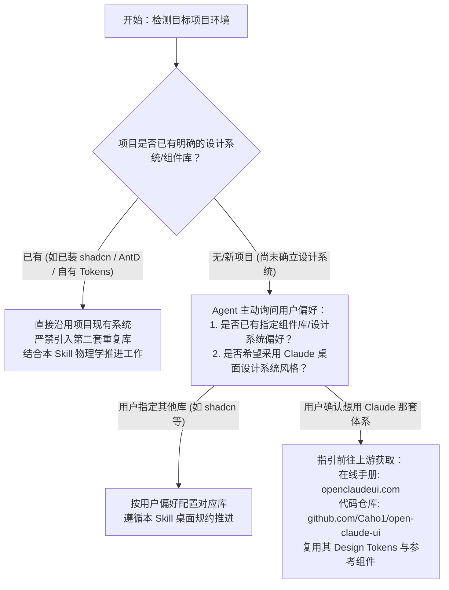

# 桌面 Agent UI 设计与工程规范

把桌面应用的实际操作体验与 Agent 的自主可控性紧密结合。适用于现代桌面工作台、多面板 AI 交互界面、独立弹出窗口，以及桌面端高频返工问题的定向排查与修复。

本 Skill 汇总了现代桌面端生产级实践与深度工程架构，涵盖组件系统、状态流、交互物理学与踩坑防御规约。

## 按任务读取

| 当前任务 | 必读参考 | 核心产出 |
| --- | --- | --- |
| 借鉴现代桌面体系、拆解组件与工作区 | [桌面参考实现手册导读](references/open-claude-manual.md) | 结构分层、组件状态机、Zero-JS 纯 CSS 滚动驱动动效与可迁移机制 |
| 修桌面窗口、阴影裁切、滚动跳动、图标与焦点 | [桌面工程经验与防复发指南](references/desktop-pitfalls.md) | 根因排查、双层裁切分工、滚动槽位锁定与真实渲染验证 |
| 设计 Agent 工作台、会话状态、工具调用与画布 | [Agent 交互与任务状态](references/agent-interaction.md) | 任务生命周期、RICH 委托控制权、三层披露与产物分层 |
| 细化输入框、自适应高度、消息跟随、动效契约 | [组件实现与动效契约](references/components-motion.md) | 果冻增高与局部隐藏原生滚动条、CJK 输入法 500ms 守卫、分栏吸附闭环 |
| 交付检查、阴影审计与真实环境验收 | [质量验收清单](references/acceptance.md) | 自动化阴影裁切审计（clip-audit）、窗口物理边界与最小交付记录 |
| 溯源技术分类与规范背景 | [架构与参考索引](references/sources.md) | 知识点与工程背景对应表 |

建议按需读取对应参考文件，无需每次全量加载。例如处理裁切问题时，重点查阅 [桌面工程经验](references/desktop-pitfalls.md) 与 [验收清单](references/acceptance.md)。

## 设计系统与组件库决策流（Design System Decision Flow）

> [!IMPORTANT]
> **技术栈与设计系统完全中立**：本 Skill **没有预设、不设定、也不包含任何特定的组件库或设计系统代码模板**。它专注于桌面 Agent 交互物理学、状态机与避坑验收门禁。无论项目使用 `shadcn/ui`、`Ant Design`、`Radix UI`、`Tailwind CSS` 还是原生自绘，本规范均通用生效。

在开启涉及新界面开发或组件选型任务时，Agent 必须遵循以下决策树：



1. **自动探测（Auto-Detection）**：先检查项目 `package.json`、样式表与组件目录，判断是否已存在既定设计系统；
2. **已有系统不折腾**：只要项目已具备成熟组件或设计令牌，直接继续推进，严禁为了“风格统一”强行重构；
3. **从零起步先询问**：未检测到设计系统时，不得擅自替用户做主引入庞大框架，向用户确认设计方向；
4. **按需向上游获取**：若确定需要复刻或借鉴 Claude 设计系统（Claude Design System），直接查阅上游 [Open Claude UI](https://github.com/Caho1/open-claude-ui) 及 [在线手册](https://openclaudeui.com/) 获取其 Design Tokens 与生产级参考实现。

## 推荐工作流

1. **审视基础与环境**：确认当前项目技术栈（Electron / Tauri / Web）、窗口框架（无边框透明 / 自绘标题栏）、用户实际操作任务以及本轮改动边界。
2. **确认交互形态**：区分是局部细节修复还是全局布局重构；若涉及新界面架构分歧，先输出可审阅的结构原型。
3. **匹配对应经验与规约**：对照避坑指南核验，确认是否命中阴影外扩超限、CJK 伴生输入冲突、滚动条跳动、多窗口状态冲突，以及排版视觉精致度门禁。
4. **最小可验证实现**：优先复用成熟组件库与系统原生交互语义，状态机与物理焦点先于修饰性动效。
5. **真实环境闭环验收**：桌面壳行为必须在实际桌面运行时（真窗、透明背景、真实滚轮与输入法）进行校验，执行 `clip-audit.js` 确保 `cut === 0`，并核验视觉与文案规范。

## 界面排版、文案与视觉精致度八大铁律（UI Refinement & Craftsmanship）

在实现、优化与 review 任何界面时，Agent 必须强制遵守以下 8 条视觉与交互精致度铁律：

1. **禁用中点分隔符**：严禁使用中点 “·” 作为文案或标签的分隔符。若界面中已存在，一律将其移除，改用布局留白、微弱色阶标签或极细分隔线。
2. **剔除冗余解释性描述**：严禁在卡片、模块与表单中滥用副标题、占位式 slogan 或说明书式辅助提示。冗余文案不仅会弄脏 UI 界面，还会浪费用户的宝贵注意力；依赖排版层级、间距与组件布局本身传递结构和意图（Let the layout do the explaining）。
3. **文案场景化审查（Tone & Concision）**：审查界面文案时，确保措辞与当前界面面向的目标人群高度契合。做到清晰好懂、容易理解，但不过于口语化或轻佻；文字长短严密匹配功能场景与控件尺寸，严禁冗长堆砌与随意生造新词。
4. **光学对齐与同心圆圆角（Concentric Border Radius）**：
   - 优化界面元素与排版的对齐效果，以视觉重心的“光学对齐”为准，而非单纯依靠几何边界机械居中；
   - 存在容器嵌套时，必须做同心圆圆角处理：内层圆角 $R_{inner} = \max(0, R_{outer} - padding)$，杜绝内外圆角不平行导致的生硬凹凸感。
5. **精细边框标准（0.5px Borders）**：凡需使用线条、容器描边或卡片边框时，统一使用极细的 **0.5px** 边框（在高分屏/Retina 屏下呈现精致轻盈的半像素 Hairline 质感），拒绝笨重粗边框。
6. **字号阶梯收敛（≤4 种，推荐 3 种）与 12px 最小门禁**：
   - 全页面出现的文字字号严禁超过 4 种，推荐严格控制在 3 种以内；
   - 界面上最小可用文字尺寸硬性规定为 **12px**，严禁使用小于 12px 的字体损害可读性；
   - 当需要表达更多信息层级时，优先通过**字重（font-weight 400/500/600）、字体灰阶/色彩对比（muted/subtle）以及间距设计（spacing）**来调整层次结构，而非随意增加新字号。
7. **决策负荷收敛与优先级秩序**：
   - 尽量减少页面中需要用户主动停下进行判断的交互阻断；必须由用户做决策时，将选项直接放置在用户原本就打算做选择的自然路径上；
   - 重新审视页面中包含的功能与元素，基于用户真实场景判断信息优先级，使用更有秩序、结构化的做法进行精简与组织。
8. **克制使用圆角与阴影，严禁左边缘彩条卡片**：
   - 尽量不要随意在页面中使用圆角和阴影；若功能场景确需使用，必须严格审定其数值（如仅窗口、浮层 Popover、按键赋予明确层级），避免无意义的装饰性堆砌；
   - **严禁使用“卡片左边缘带颜色的线条”（彩条卡片）**这一过时、碎片化且破坏整体现代感的装饰性反模式。

## 核心设计与工程铁律

- **动作与状态严格真实对应**：草稿、已提交、排队中、执行中、等待授权、已完成、失败、已终止必须以底层真实事件为准；严禁用动画延迟或前端计时器伪造执行进度。
- **用户对 Agent 的完整控制权**：明确用户何时可以编辑草稿、补充上下文、中止任务以及安全重试；必须展示清晰的执行影响范围。
- **捍卫桌面原生语义**：窗口控制区、系统快捷键、焦点捕获、文本选择、IME 组合输入与原生滚动各有归属；自绘界面必须完整保留原生交互契约。
- **成熟组件与架构优先**：复杂弹窗、伸缩分栏（Resizable）与拖拽交互坚决复用成熟库；明确区分系统原生滚动、组件库 ScrollArea 与自绘 thumb。
- **内外分层的裁切规约**：圆角内容裁切放内层，投影与阴影放外层。涉及阴影或透明窗口时，执行 `scripts/clip-audit.js` 进行自动化测算，阴影外扩距离必须满足 `offset + blur + spread` 的物理余量要求。
- **真实证据沉淀**：保留修改前报错现场、修改后运行证据与截图。

## 目录结构

```text
desktop-agent-ui/
├── SKILL.md
├── README.md
├── LICENSE
├── references/
│   ├── open-claude-manual.md     # 桌面参考实现手册导读与深度工程机制
│   ├── desktop-pitfalls.md       # 桌面工程经验、高频返工与避坑指南
│   ├── agent-interaction.md      # Agent 交互、状态流与控制权体系
│   ├── components-motion.md      # 组件实现、动效契约与输入框配方
│   ├── acceptance.md             # 自动化裁切审计与全量验收清单
│   └── sources.md                # 架构分类与技术参考索引
└── scripts/
    └── clip-audit.js             # 阴影与祖先裁切自动化审计脚本
```
