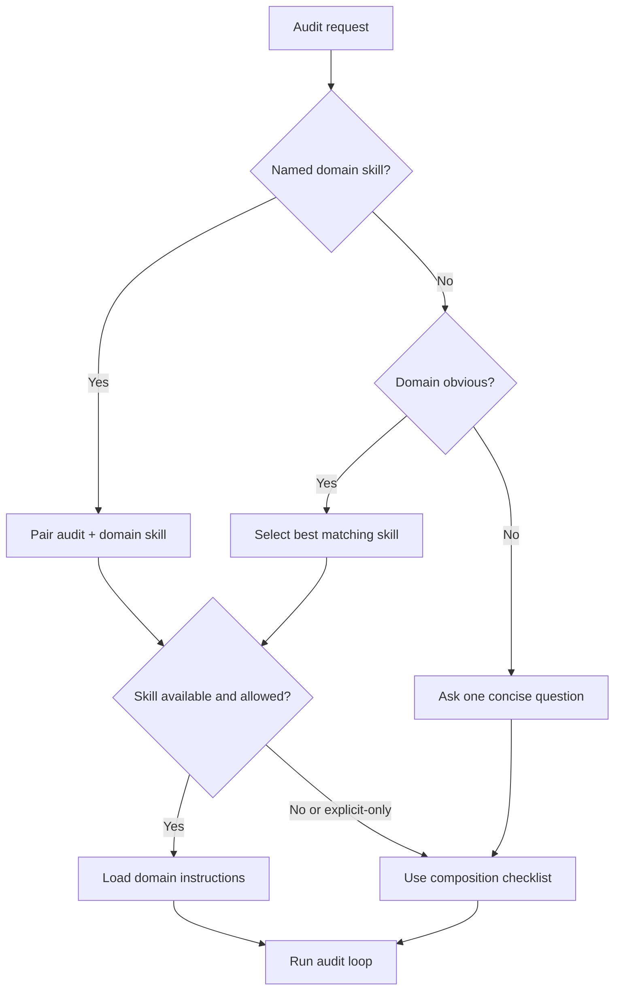
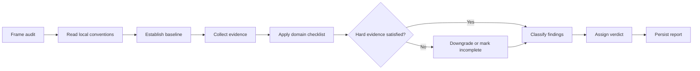
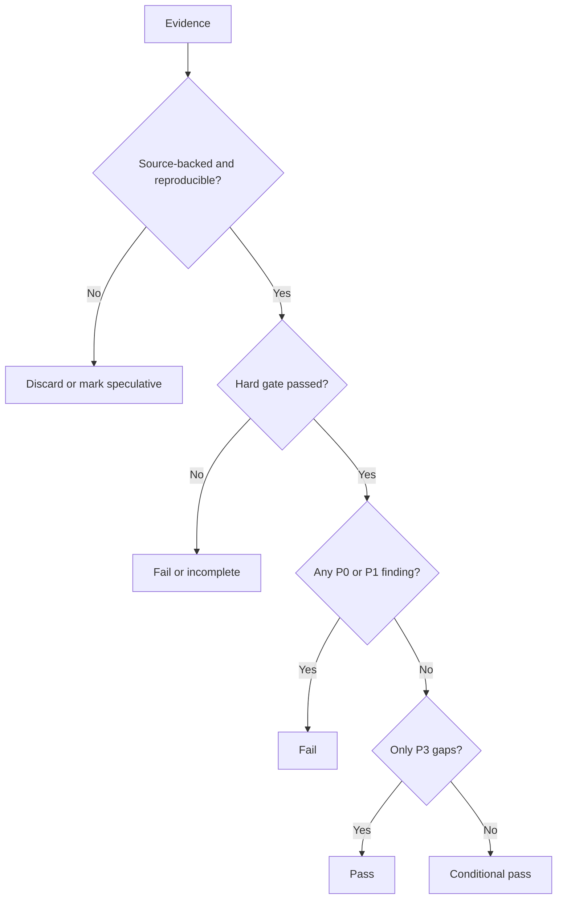

# Audit Anything

Run a structured audit, not a general code review. The audit skill owns scope, evidence discipline, severity, coverage, verdict, and report persistence. A paired domain skill supplies domain vocabulary and inspection criteria. Do not let a domain skill turn the audit into implementation work.

## Pairing flow



## Pairing contract

1. Identify the audit domain from the request or target artifact. If the user named another skill, read and use it together with this skill.
2. If no domain skill is named but the domain is obvious, use the best available matching skill; for example, pair with `frontend-design` for visual/UI design review, `improve-codebase-architecture` for architecture review when explicitly requested, `database-schema-designer` for schema review, or `ai-agent-workflow` for agent workflow review.
3. If the domain is genuinely ambiguous, ask one concise question before spending effort on the wrong target.
4. Do not silently invoke a skill that is marked explicit-only or model-disabled. Ask the user to invoke it or proceed with the corresponding checklist in [references/compositions.md](references/compositions.md).
5. Keep the paired skill's creative or planning workflow subordinate to audit mode. Do not redesign, refactor, install dependencies, or fix code unless the user explicitly asks for fixes.

## Audit modes

Select the narrowest mode that satisfies the request:

| Mode | Target | Minimum evidence |
|---|---|---|
| Change audit | Diff, commit, or PR | Full diff, surrounding call paths, tests |
| Module audit | File, component, service, or workflow | Entrypoints, dependencies, state flow, tests |
| System audit | Architecture or domain model | Directory map, module boundaries, data/control flow, ADRs or docs |
| Live product audit | Running app | Real interaction, screenshots, console/network output where applicable |
| Contract audit | API, schema, event, or data model | Interfaces, callers, constraints, migrations, failure cases |
| Document audit | Plan, spec, IA, user flow, report | Full artifact, referenced sources, consistency with implementation |

For code-change reviews where the user only wants defect findings, prefer `review-agent`. Use this skill when the user asks for a broader audit, domain assessment, or a persisted report.

## Execution loop



## Process

1. **Frame the audit.** Record target, domain, pairing, mode, intended user, constraints, and whether the scope is a change, module, system, live product, contract, or document.
2. **Read local conventions.** Read applicable `AGENTS.md`, README, docs, ADRs, glossaries, and existing audit reports before judging the target.
3. **Establish a baseline.** Run relevant read-only checks such as tests, typecheck, lint, build, schema validation, or dependency inspection. Do not run destructive commands or request external services without authorization.
4. **Inspect with evidence.** Read the complete requested artifact plus enough surrounding code or docs to understand behavior. For live products, interact with real flows and capture observable proof.
5. **Evaluate across the paired lens.** Use the domain checklist from [references/compositions.md](references/compositions.md). Common dimensions are correctness, security, reliability, performance, maintainability, state handling, testability, observability, accessibility, and documented intent.
6. **Report only actionable findings.** A finding needs concrete impact, evidence, and a smallest viable fix direction. Do not include speculative concerns, pre-existing issues outside the stated scope, or style nits that do not obscure behavior.
7. **State coverage honestly.** List what was inspected, what was sampled, and what could not be verified. Missing access, credentials, services, or runnable state makes the verdict incomplete rather than pass.
8. **Persist the report.** Unless the user asks for chat-only output, write the full report to `docs/audits/YYYY-MM-DD-<domain>-<target>.md` when a `docs/` directory exists. If there is no `docs/` directory, save to the OS temp directory and provide the absolute path.
9. **Summarize in chat.** Lead with the verdict and highest-impact findings, then mention the report path and recommended next action.

## Evidence gate



## Findings and verdict

Use these priorities:

- `P0`: release blocker or critical correctness/security/data-loss issue.
- `P1`: high-impact defect or risk that should be fixed soon.
- `P2`: ordinary defect, gap, or maintainability issue.
- `P3`: worthwhile polish or documentation improvement.

Use one verdict:

- `Pass`: no P0/P1 findings and all agreed hard gates are green.
- `Conditional Pass`: no P0/P1 findings, but P2/P3 gaps remain.
- `Fail`: one or more P0/P1 findings or a failed hard gate.
- `Incomplete`: required access, interaction, build, test, or evidence is missing.

Every finding must have:

1. A one-line imperative title with priority.
2. Evidence with file/line, command output, request/response, screenshot, schema, or artifact quote.
3. Affected scenario or user workflow.
4. Why it matters in the paired domain's terms.
5. The smallest concrete next change, not a vague suggestion.

Report format:

```markdown
# <Domain> Audit: <Target>

Date: YYYY-MM-DD
Scope: <artifact or boundary>
Pairing: audit + <skill or explicit lens>
Mode: <audit mode>

## Verdict

<Pass / Conditional Pass / Fail / Incomplete>

## Flow evidence

Use one or more Mermaid diagrams when they clarify state, sequence, ownership, trust boundary, or failure path. Prefer a diagram for any workflow that spans multiple components or decision points.

## Findings

### [P1] <Imperative finding title>

- Evidence: <path:line, output, screenshot, or quote>
- Impact: <affected workflow and why it matters>
- Next change: <smallest concrete fix direction>

## Coverage

- Inspected: <list>
- Sampled: <list>
- Not verified: <list and why>

## Roadmap

1. <Immediate / P0-P1 action>
2. <Structural action>
3. <Polish or documentation action>
```

Read [references/compositions.md](references/compositions.md) for domain-specific pairing, inspection questions, and hard evidence requirements.
