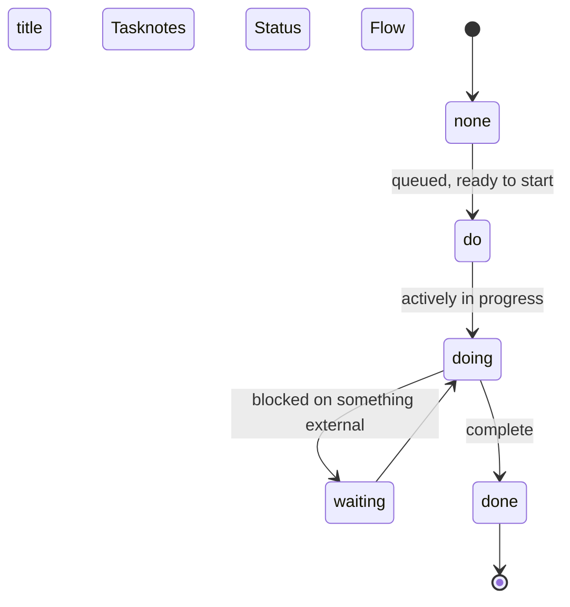

# /ob-task-notes

Task notes are single-file work documents managed by the
[TaskNotes](https://tasknotes.dev/) Obsidian plugin. They live in
`TaskNotes/Tasks/` within the Vault.

## Tools

Two tools are available — prefer them in this order:

1. **`tasks.py` script** (HTTP API) — use for all **writes** (create, update,
   complete, archive) and for **filtered queries**. Requires Obsidian to be
   running with HTTP API enabled (port 28084). Run with:
   ```bash
   uv run <skill-path>/scripts/tasks.py <command> [options]
   ```

2. **`mtn`** (mdbase-tasknotes) — use for **reads when Obsidian isn't running**,
   or as a fallback if the HTTP API is unavailable.

3. **obsidian CLI** — use for reading full note body content or appending text.

---

## Task Schema
Described in https://tasknotes.dev/spec/02-model-and-mapping/
```yaml
title: Review quarterly report
status: do            # do | doing | done | waiting | none
priority: bland       # hot | spicy | mild | bland | none
due: 2026-04-01       # ISO date, optional
scheduled: 2026-03-29         # ISO date, optional
dateCreated: 2026-03-27T00:00:00.000Z
dateModified: 2026-03-27T00:00:00.000Z
tags:
  - task              # always required
  - GenAI             # add if you write the full note content
contexts: 
  - "@work"              # classify where or how a task belongs
  - "@desk"              
projects:
  - "[[Related Note]]"   # a wikilink to TaskNote, optional
```
The frontmatter contains structured, queryable properties. The note body holds freeform content—research findings, meeting notes, checklists, or links to related documents.



**Priority:** `hot` (serious consequences if not done), `spicy`, `mild`, `bland` (no consequences if not done)

---

## Querying Tasks (tasks.py)

```bash
TASKS="uv run <skill-path>/scripts/tasks.py"

# All tasks (paginated, default 50)
$TASKS list

# Filter by status
$TASKS list --status doing
$TASKS list --status do

# Filter by priority
$TASKS list --priority hot
$TASKS list --priority spicy

# Overdue tasks
$TASKS list --overdue

# Filter by tag
$TASKS list --tag work

# Combine: hot + not done (use --priority + check status in output)
$TASKS list --priority hot
```

Output is JSON with `tasks[]` array, each having `id`, `title`, `status`,
`priority`, `due`, `scheduled`, `tags`, `projects`.

---

## Creating a Task (tasks.py)

Use explicit fields to be deterministic, not depending on NLP parsing:

```bash
$TASKS create "Task title" \
  --status do \
  --priority spicy \
  --due 2026-04-03 \
  --tags "work,p10" \
  --project "Project Note Name"
```

The `task` tag is always added automatically. Project names get wrapped in
`[[wikilink]]` format.

**GenAI tag:** Add `--tags "work,GenAI"` (or whatever other tags plus GenAI)
when you're writing the full task content — this lets the user track
AI-authored notes.

Returns JSON with `data.path` (the created file path) and `data.id`.

---

## Project hubs

A multi-file project gets a folder whose **hub** is a task note inside it, named after the folder: `Projects/<Name>/<Name>.md`. The vault's `Meta/Project Folder Convention.md` is the full rule; read it before touching a project folder.

- **Create** a hub by writing the file from the vault's `Templates/Project Hub Template.md` (not with `tasks.py create`, which files into `TaskNotes/Tasks/`). Set `title` to exactly the folder name and keep the `task` and `project` tags. TaskNotes finds tasks by tag, so the hub still shows up in every view.
- **Sub-tasks** stay in `TaskNotes/Tasks/`: `$TASKS create "…" --project "<Name>"`.
- **Close** a hub with `status: done`. **Never archive a hub**: the Archive action moves it out of its folder.
- **Rename** a hub only by renaming its folder in Obsidian (Notebook Navigator renames both and rewrites links). Never `mv` a project folder or hub from the shell.
- Don't add `project_dir` (legacy) or make a `README.md` hub.

---

## Updating a Task (tasks.py)

Use the task's file path as the ID:

```bash
# Change status
$TASKS update "TaskNotes/Tasks/My task.md" --status doing

# Change priority and due date
$TASKS update "TaskNotes/Tasks/My task.md" --priority hot --due 2026-04-01

# Mark done
$TASKS complete "TaskNotes/Tasks/My task.md"

# Archive (never a project hub; see "Project hubs")
$TASKS archive "TaskNotes/Tasks/My task.md"
```

---

## Reading Full Note Content (obsidian CLI)

For reading the body (steps, context, decisions) use the obsidian CLI.
Always append the log filter:

```bash
LOG="2>&1 | grep -v 'representedObject\|Loading updated\|out of date\|installer\|Loaded main\|Ignored\|Checking\|Success\|Latest version\|App is up\|Obsidian\['"

obsidian vault=Vault read file="Task title here" $LOG
obsidian vault=Vault append file="Task title here" content="- [ ] New step" $LOG
```

---

## Fallback: mtn (when Obsidian is closed)

```bash
mtn list --status doing
mtn list --priority hot
mtn list --overdue
mtn stats
mtn complete "Task title"
```

---

## Body Structure (for rich task notes)

When creating a full task note (not just a stub), write the body like this:

```markdown
# Task Title

> [!NOTE] Context
> Why this task exists. What it's part of. Relevant links.

## Steps

- [ ] First concrete step
- [ ] Second step
```

Add sections as needed: Open Questions, Decisions, Reference.
Use the obsidian CLI to append a body after creating via `tasks.py`, or
create the full note directly with the obsidian CLI if a rich body is needed
from the start.
