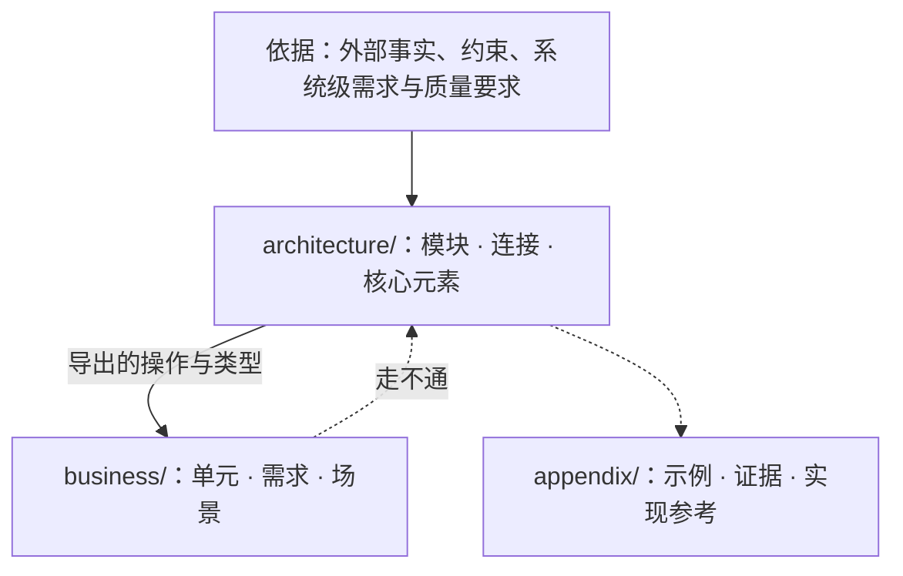

# ssot

完整通过检查的示例设计见 [`references/example/design/`](references/example/design/)。

**默认工作边界：只专注 `design/` 本身。** 执行任何 `ssot` 任务时，**默认禁止查看目标仓库中 `design/` 之外的任何文件（包括实现代码、测试、配置文件、其他文档，以及 `legacy-design/`），也禁止查看 `git` 历史或 diff**；`legacy-design/` 仅在当前任务明确是执行 `ssot-migration` 存量迁移时才允许读取；`ssot-draft` 与 `ssot-verify` 另可读取用户明确提供的需求材料，`ssot-draft` 在目标仓库的 `.tmp/ssot-draft/` 写草稿，`ssot-design` 读取这份草稿并在 `.tmp/ssot-design/` 写落点台账，`ssot-verify` 在 `.tmp/ssot-verify/` 写各验证方的验证台账（不读草稿与落点台账）。用户给出的是原始来源设计（旧设计文档、旧说明等，而不是本轮的需求）时，任何块都不直接读它：`ssot-draft` 派发 `ssot:reader` 代读，只读它写的 `.tmp/ssot-draft/source/` 与 `.tmp/ssot-source/requirements.md`（规则见 `ssot-draft` 第〇节）；`ssot-migration` 例外，它本来就是要无损搬运原文。**禁止使用 `discuss`、`mentor`、`task:*` 等通用 subagent**（仅 `ssot-draft` 按其自身规则使用本 skill `agents/` 目录下预置的 `ssot:reader`，`ssot-verify` 按其自身规则使用 `ssot:argon` 与 `ssot:fable`）。验证 `design/` 时只以 `ssot` 系列 skill 与 `design/` 自身为准，不受目标仓库 `.claude/rules/` 中既有模块划分或旧审查条文的预设绑架；运行 `ssot` 命令行工具直接用终端工具（如 `exec_command`），不绕用 Python `eval` 调 `subprocess`。不要找任何借口去翻看 `design/` 之外的内容；如果确实认为某一步非看某个外部文件不可，只能向用户提议并等待许可，绝不是默认行为。

---

## 一、设计的思路

### 1. 视角与权衡：到底需要定义什么
无论是架构还是业务，描述“值”的地方，和描述“动作”的地方，往往不在同一个地点。

想象一只兔子跳跃：
- 值只是兔子的属性，兔子能跳不代表它是某种特别的动物。如果问“为什么兔子能跳”，只盯着兔子去找它身上的肌肉，就走进了思维死角——兔子能跳，首先得有地面承载跳跃的反作用力。
- 而解释“什么是跳跃”，也不是兔子自己说了算：当腿对地面施加反冲力后，一只脚离地算跳跃吗？两只脚离地算跳跃吗？这时候纳入的观察者绝不只有兔子本身。
- 但软件不要求把所有视角都观察一遍，也不一定只观察某一个视角：
  - 当软件是用来**测量兔子的力量**时，观察对象就只有兔子和地面；
  - 当软件只是想知道**兔子跳了多远**时，观察对象几乎不关注兔子本身，甚至连地面也不关心——因为空间坐标可以只有相对值，参照物是什么都行。

因此，**到底有哪些东西需要被定义、怎么定义，是在多个视角下的权衡**。同一样东西，在持有它的模块里是细节，在别的模块里是概括性的占位符，实际需要时才展开。以信号灯为例：

```vdm
SignalColour = <Red> | <Amber> | <FlashingAmber> | <Green>
```

- **定义在持有者。** 信号灯有这几种状态，所以 `SignalColour` 定义在信号灯的模块里；`=` 右边是信号灯自己的细节。
- **观察者需要才展开。** 谁需要观察信号灯？观察者需要知道状态，才写出细节；不需要，它只是一个定义的点（`token`）：这里有个信号灯，用来干什么。具体怎么运作，是信号灯自己的机制。
- **行为归做出行为的一方。** 信号灯是红灯时不允许通过路口，这是司机的行为，不是信号灯的行为，写在司机那里。
- **规则归持有者。** 信号灯能从红色切换到绿色，是因为满足一条倒计时状态规则。离线信号灯自己持有这条规则，它在信号灯里是细节；联网信号灯是这条规则的消费者，它在信号灯里只是概括。谁持有规则，决定规则在一个模块里是概括还是细节。
- **隐含前提是软件的一部分，就有它的位置。** 不能通过路口，前提是车必须行驶在路上：车不能飞在天上。路不直接出现在这里，但和车有关系。这样的前提如果是软件的一部分，它在程序里可以解释：它是外部依赖时，在这里是占位符，经导入可以找到它；它在本系统里实现时，可以在实现它的地方找到它的细节。隐含前提不是软件的一部分时，例如服务器需要电力运行，就不写进设计。
- **展开是可选的，但只有一次。** 一样东西可以不展开，但展开只能有一处；展开了两处，它就有多重解释。
- **默认是最小形式，展开是要讲理由的例外。** 名字需要存在、内部还没有约束要求时，类型写 `token`，连接与判定写 `is not yet specified`；字段、分支、状态分量、参数、`pre`/`post`/`inv` 合取项与显式体，只在某条约束用更小的形式表达不了时才加。占位不需要理由，展开要逐项说明缩回去会让哪种违反情形重新可以构造；展开得多不说明设计更完整。怎样不展开也守住约束：身份只比较相等，判定写成不展开的函数放进 `pre`/`post`，事实写成身份之间的映射与集合，结局只列调用方要区分的分支，连接只留签名（写法与例子见 `ssot-design/references/writing.md` 第三节）。

### 2. 透过 VDM 形式看设计本身：设计长什么样、需求要满足什么
VDM 只是写设计稿的一种形式，用来把想法写准确，但它不是设计本身。无论写设计还是审设计，**都不能按 VDM 的字面意思去抠符号**：

- **重点是“需求要满足什么、设计到底长什么样子”：** 面对一份设计，首先要问的是——这个系统要满足什么需求？为了满足这些需求，这个设计整体长什么样子、本来应该长什么样子？如果不能先回答这个问题，反而一上来就盯着 VDM 字面去问“要把哪些字段删掉、把哪些参数接上”，就是**本末倒置**。
- **顺眼与不顺眼（积压感与责任边界）：** 看设计不是拿着清单找字面茬，而是看它的整体模样**顺眼不顺眼**。如果一个地方被积压了或者展开了太多的值，通常意味着这个地方有多个来源或多个视角要处理，责任边界不清晰——不可能所有的业务都在一个地方集中处理。
- **直面大体框架：** 审代码往往尽可能保住既有的大体框架，在里面看缺不缺某个函数或某个值；而 SSoT 在长期维护中保持不变，直面它时看的不是字面上修修补补的小打小闹，而是更深层的大体框架：为了满足需求，在这套软件所选的视角下，设计应该长什么样、到底有多少东西需要被定义、定义得对不对。

### 3. 核心、连接与不变量
- **设计只写核心，常变的业务留在代码里。** 核心定下之后不再常改；建在核心之上、随需求变动的业务写在代码里。在连接不变时可以替换的做法属于实现，不写进设计；一段细节保护某条不变量时，设计只写这条不变量。
- **架构与优先级。** 架构回答三个问题：**由什么组成**（有哪些模块，谁在谁里面）、**用什么组成**（模块由哪些核心元素拼成，经哪些连接相接）、**为什么**（依据哪些外部事实、约束与需求）。业务建在架构上，只经连接接入；业务引用架构，架构不引用业务。
- **两条轴。** 抽象层级是模块树的深度（父模块粗、子模块细，父不依赖子，共用材料放共同父模块）；模块划分是每个架构模块固定的三部分（外部连接、核心代码、内部设计）。业务单元不分这三部分，但业务也有抽象：业务单元之间只经导出的连接点对点或点对面组合。
- **连接、状态与生命周期。** 连接点是可以被调用的操作或函数；共享同一份状态与同一条不变量的一组操作构成连接面。说做到什么（隐式 `pre`/`post`），不说怎么做；两个实现必须算出同一结果的判定写成显式纯函数（`functions`）；需求要求的跨连接先后（包括失败之后的恢复次序与生命周期中断）写成场景（`operations`），失败结局本身写进结局类型与 `post`。不变量、前置条件、后置条件各管一件事，不变量越简单越好。
- **读懂 VDM 形式的三个基本约定（不用写业务代码的习惯误读规格）：**
  1. **从函数与值出发，不从持久化存储出发：** 连接面的 `state` 是用来直观陈述本面不变量（`inv`）与操作前后关系（`post`）的说明性数学模型，不是内存结构体或数据库表（不对连接面内部的集合/映射做“合并字段”式重构，也不追问外部环境句柄如 `Config = token` 在重启后从哪张数据库表里读取）；跨概念的上层业务状态则写成源头事实上的纯函数投影。
  2. **显式体不写循环，集合需求由“全集纯函数 + 单步代表元场景”配合表达：** VDM-SL 显式体禁止写局部变量、赋值与循环。涉及集合元素的需求，由显式纯函数（`functions`）算出全集划分或候选集合，再由显式场景操作（`operations`）接收单个代表元参数走通单步连接调用——不把接收单个代表元参数的场景误判为“与全集需求形状不符”或“漏写循环”，也不把场景里重复出现的收尾分支当成“代码重复没抽共用辅助函数”。
  3. **准入契约与可观察结局分清：** 连接的 `pre`/`post` 前置状态条件是调用方获准调用的准入契约，契约之外的违规调用不需要列为返回值结局分支；结局并类型只列调用方在遵守契约时仍必须区分处理的分支。

---

## 二、三桶目录与阶段 Skill 路由



| 目录 | 角色 | 约束 |
|---|---|---|
| `design/README.md` | 阅读次序导航 | `architecture/` 与 `business/` 下的每个 `.md` 恰好出现一次；不写规则 |
| `architecture/` | 根模块与子模块：核心概念、对外连接（`exports`）、状态与不变量 | 不引用 `business/`；父模块不依赖子模块；不包含只为单一业务单元存在的类型或规则 |
| `business/` | 业务单元：需求、确定性判定与接入场景 | 单向 `imports` 架构导出的连接；业务单元之间只经导出连接无环组合 |
| `appendix/` | `examples/`（示例）、`evidence/`（依据的证据）、`reference/`（实现参考） | 不出现在阅读次序里，不被 `check` 检查，不设立规则 |

## 三、路由门控（一次只执行一块，未明确前不继续、不读其他 Skill）

1. **用户未明确告知具体要做哪一块时——先问清楚，立即停下：**
   - 如果用户只说“review design”“检查 design 对不对”或“写/改 design”，而没有明确指出本次是下面哪一个具体的块（哪个子 skill），**必须先列出对应的选项询问用户本次要做哪一块**。
   - **在用户明确告知之前，不得继续往下执行，不得读取任何其他子 skill，也不得读取 `design/` 文件。**
2. **用户明确告知具体哪一块后——必须完整读完对应的那一个子 skill 并独立执行：**
   - 用户在指令中已指明、或在追问后选择了具体哪一块后，**必须读取且完整读完那一个对应的子 skill**；
   - **严禁顺手读取其他块的子 skill**，完成当前块并交付结果后即停下。

### 1. 写设计与验证设计

写设计按 `ssot-draft` → `ssot-design` 的次序；审查、检查设计对不对用 `ssot-verify`。

| 块 | 对应 Skill | 重心 |
|---|---|---|
| **设计草稿** | `ssot-draft` | 写 VDM 之前分清对象，写出每条约束允许的变化与不变的关系，判定由架构还是业务持有；只写 `.tmp/ssot-draft/`，不改 `design/` |
| **按草稿写设计** | `ssot-design` | 把草稿里的约束写进 `design/`，架构模块与业务单元一起写；每个 VDM 元素都对应草稿中的一条约束；附写法参考与落地判据 |
| **独立验证** | `ssot-verify` | 由未参与设计的 `ssot:fable` 与 `ssot:argon` 先写出应有长相与应有约束，再逐条找违反情形，逐项审查元素、场景、调用、文字与模块，核对归属；只报告，不修改 |

### 2. 存量旧文档迁移

| 块 | 对应 Skill | 迁移重心 |
|---|---|---|
| **存量文档迁移** | `ssot-migration` | 只搬运、不判断对错、不改动原意，把 `legacy-design/` 原样拆层搬进 `design/` 直至搬空 |

---

## 四、命令与检查概览

命令 `ssot` 与 `vdmj` 在 PATH 上，直接调用。不在 PATH 上时，运行一次 `bun ~/.agents/skills/ssot/scripts/design.ts setup` 安装（细节见 [`references/setup.md`](references/setup.md)）。

| 命令 | 作用 |
|---|---|
| `ssot init <仓库根>` | 生成 `<仓库根>/design`：`README.md`（阅读次序）、根模块 `README.md`、三类附录目录 |
| `ssot module <design> <a/b>` | 建立架构子模块目录与 `README.md`，并加入阅读次序；父模块必须已存在 |
| `ssot unit <design> <名字>` | 建立业务单元目录与 `README.md`，并加入阅读次序 |
| `ssot check <design> [--json]` | 检查全部规则（`layout`、`parse`、`structure`、`antipattern`、`form`、`prose`、`typecheck`、`quickcheck`），有违规时退出码为 1 |
| `ssot graph <design> [--json]` | 输出目录、模块与 `imports` 关系的 Mermaid 图或 JSON |
| `ssot vdmj <design> [参数]` | 用设计里的全部规格运行 VDMJ，例如 `-i` 进解释器、`-e` 求值 |
| `ssot review <design>` | 输出语义反模式模型审查的判断对象（JSON），由 `scripts/review.py` 在 omp `eval` 里交给 `jev` |
| `ssot draft <子命令> <仓库根>` | 核对草稿 `.tmp/ssot-draft/draft.yaml`：`requirements`、`objects`、`constraints`、`owner`、`excluded`、`tradeoffs`、`status`；第一次运行时记下本轮开始的设计基线 `.tmp/ssot-draft/baseline.yaml` |
| `ssot design <子命令> <design> [--stamp …]` | 核对落点台账 `.tmp/ssot-design/`：`check`、`elements`（本轮新增、改动、删除的元素）、`constraints`、`status` |
| `ssot verify <子命令> <design> --as <验证方> [--dir …] [--constraint …] [--stamp …]` | 核对验证台账 `.tmp/ssot-verify/<验证方>/`：`check`、`expect`、`gaps`、`overview`、`attack`、`elements`、`scenarios`、`flows`、`prose`、`modules`、`owner`、`po`、`review`、`verdict`、`status`、`report` |
| `vdmj [参数] <文件>` | VDMJ 本身，带 QuickCheck 插件，读 `.vdmsl` 文件；设计目录里的 Markdown 用 `ssot vdmj` |

### 逐项判断的台账

`ssot draft`、`ssot design`、`ssot verify` 不替判断者下结论，只保证每一项都判了。规则对三者相同：

- **义务由工具枚举。** 需求块来自需求材料，元素、场景节点、调用点、`ext` 与导出来自规格的语法树，段落来自 `README.md`，目录来自设计目录，证明义务来自 VDMJ，应有约束与草稿约束来自判断者写下的清单。没有记录的义务报错（缺判），并打印可以照填的 YAML 骨架；记录对应的义务已不存在时也报错（孤儿），按骨架重判。
- **台账只由判断者写。** 台账是 YAML，按子命令分目录；同一子命令可以拆成多个文件，便于分批与并行，一项义务只留一条记录。槽位没填、取值不在范围内、字段拼错、引用的元素或 `路径.md:行` 找不到，都是错误。
- **盖章与过期。** 记录核对无误后加 `--stamp` 盖章：工具在同名的 `.stamp.yaml` 里记下记录本身与它依据的原文（被判断的对象、引用的元素、所属的约束）。之后记录改了要重新盖章；依据的原文变了，记录过期，工具并排给出盖章时与现在的原文。重新判断后改写记录再 `--stamp`，或确认结论不变后用 `--stamp <键>` 逐条确认；只写 `--stamp` 不会替你确认过期的记录。
- **错误与警告。** 错误是没判完，退出码为 1；警告是判断本身给出的问题或不确定（遗漏、过强、未能判定、不该进 VDM 等），逐条看过再交付。警告不要求清零：看过之后判断保留的，照样交付，并在交付里列出。
- **修法先减后加。** 任何错误、警告或验证问题，修法先问被诊断的东西有没有草稿约束来源：没有就删掉它、取消导出、删掉说明里多说的话，或退回 `token` / `is not yet specified`；名字要保留但内容未定的，保持占位；只有草稿约束确实要求、规格里又确实缺了，才补最小的谓词或结构，并照常记进台账。不为消掉诊断、通过编译或让证明义务成立而新增元素、字段、参数、导出、调用、守卫或谓词，也不把占位展开。
- **范围。** `ssot design elements` 只枚举本轮相对基线新增、改动或删除的元素。`ssot verify` 用 `--dir <目录>`（含子目录）与 `--constraint <编号>` 只核对一批义务；不带范围、没有错误，才算整份判完。`ssot check` 与 VDMJ 求值总是装入全部规格。
- **生命周期。** 草稿、基线与落点台账属于一轮设计，验证结论交付后删除；验证台账跨轮保留，下一轮只重判缺判、过期与孤儿（见 `ssot-verify` 第九节）。

理论与方法论文献出处见 [`references/sources.md`](references/sources.md)。
