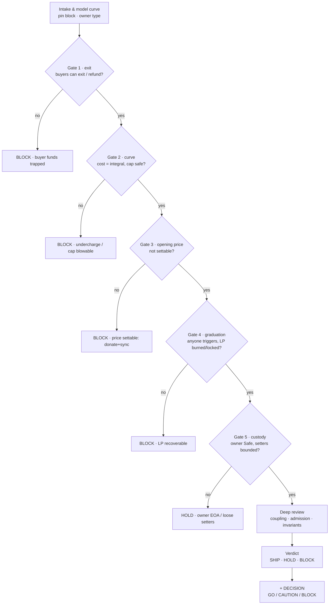

# Launch Curve Audit

A curve launch fails in ways a token audit does not look for: the price path undercharges, the budget
is consumed out of order, graduation mints into a pool nobody can exit, or the opening price is moved
before anyone trades. The money is also not the holder's — it is the buyer's, and it leaves through a
sale contract, not a transfer.

So the object here is the *sale mechanism*: pricing, admission, escrow, graduation, coupling to
whatever emits the token afterwards.

Linear P→5P with Agent-ID gating on BSC is the reference shape it was built against, but the method is
not limited to that shape — read the parameters from the contract and model whatever curve it encodes.

## Scope

In: the sale or curve contract, its pricing library, admission control (allowlist, registry, Agent ID,
per-wallet and per-identity budgets), the escrow book if any, the graduation/launch path and LP
custody, the token's pre-launch transfer lock and the tax wiring, and the emission contract the launch
hands off to.

Out: backend award logic except as a trust assumption, frontend, deploy scripts, the AMM itself, and
post-listing market risk. Say which of these you skipped.

## Intake

Collect before touching the chain; ask for what is missing:

1. Chain and addresses (token, sale, pool, book, owner). On a SPA, addresses are in the JS bundle, not
   the page — grep `0x[a-fA-F0-9]{40}` and read the surrounding config keys.
2. Curve parameters: start price, end price, supply cap, budget cap, per-identity cap, duration.
3. Admission model: open, allowlist, registry/Agent-ID, stake gate. Who can be admitted and who
   decides.
4. Graduation: what happens at cap and at deadline, who can trigger it, where the LP goes.
5. What emits the token after launch, and who can call it.
6. Verified source (Sourcify first, Etherscan v2 `chainid=56` second) and the audited commit.

An address without parameters is still auditable — read them from the constructor args and the
bytecode. Do not accept them from the docs alone.

## Evidence rules

Highest first, and drop a level only when the one above fails:

1. Bytecode and on-chain state at a pinned block.
2. Verified source, `exact_match` only.
3. A forked simulation of the exact call sequence.
4. Constructor args and deployment transaction.
5. Docs, site, and medium posts as claims to be diffed.

Hard rules:

- Price every claim in BNB and token units. "Cheap" without a number is not a finding.
- A curve property proved only by reading the comment is unproven; call it.
- Never grade a sale by its homepage. The page and the bytecode diverge — that gap is a finding of its
  own.
- Report absent functions as *absent*, not as missing, until you have the ABI. A selector can be
  missing from a scan and still be reachable through a proxy or a library.
- Pin the block. A snapshot without a block is a rumour.

## Tooling

```bash
export RPC_URL=https://bsc-rpc.publicnode.com
./scripts/snapshot.sh roles.env          # lifecycle, supply, privilege, balances
python3 scripts/curve_math.py --p <wei> --supply <units> --check 1e18,100e18 [--budget <wei>]
```

`scripts/rpc.py` is bundled for one-off calls. `snapshot.sh` also prints whether the owner is an EOA or a contract — the first thing that decides the
verdict. `curve_math.py` is a reference integral: it proves monotonicity, rounding direction, and that
no step-wise order pays less than the closed form. Both are generic; `roles.example.env` is the input
template.

## Flow

Model the curve first, then walk the gates. The four red gates are hard BLOCKs; owner custody is the
classic HOLD. Each gate maps to a Workflow step below.



## Workflow

### 0. Model the economics before reading code

Write the intended curve as a formula, from the parameters, without the implementation:
`price(x)`, `cost(a,b) = ∫price`, the cap, the admission rule, the graduation trigger.

Then check the implementation against the model. A mismatch is either a documented different design
or the finding — decide which, and say so.

### 1. Pin the deployment

```bash
./scripts/snapshot.sh roles.env
python3 scripts/curve_math.py --p ... --supply ... --check ...
```

Record block, owner type, cap, sold, raised, deadline, and current state (`tradingOpen`, `launched`).
Three floor items, each of which alone caps the verdict: owner is an EOA, deadline already passed with
no launch, cap reached with no graduation.

### 2. Price the curve

Full catalogue in [references/economics.md](references/economics.md). The four that pay:

- **Undercharge.** Rounding down on cost, or splitting a purchase into steps, pays less than the
  integral. Compare `cost(n)` against `cost(n/2) * 2` and against the closed form.
- **Overflow.** Multiplication before division without a 512-bit `mulDiv`, on a supply near `2^96`.
- **Cap admission.** A purchase at or beyond the cap must revert or truncate by rule, and the last
  unit must stay inside the budget — not silently overshoot.
- **Budget bypass.** Per-identity caps that reset per wallet, or that are booked after the transfer.

Plenty of sales have no `cost()`/`quote()` getter — the price is computed inline in a payable buy. Then
price it by state delta (`raised`, `sold` before/after) or by a fork `eth_call` of the buy function with
`value`, and record which method you used.

### 3. Run the invariants

[references/invariants.md](references/invariants.md) is the generic list; write the project-specific
ones from step 0. Prove them on a fork, with adversarial call order, funded actors, and repeated
identities. A property that holds only in the happy path is not a property.

### 4. Play the adversary

[references/attack-surface.md](references/attack-surface.md) walks the phases in order. The launch
specifics a generic audit misses:

- Donate-then-`sync()` to move the opening price, or to skip a skim.
- Buy the first unit, then trigger the tax swap or fee conversion into the gap.
- `amountOutMin = 0` on any swap the sale performs with its own balance.
- Refund reentrancy in the escrow book, and refund accounting that decrements one side only.
- Front-run the cap: last-block sniping to close a sale the team wanted open.
- Claim paths whose gas grows with entries, so rewards become unclaimable.

### 5. Graduation and custody

At cap and at deadline, the code must do one defined thing, triggered by anyone, with the LP going to
a burn or a verified locker. Check: is launch gated behind the owner, a pause, or an external registry
read? Does an empty sale still graduate? Is the LP custodied in an intermediate address? Does the
token's trading lock release in the same transaction?

### 6. Coupling

The sale is half the system. If a second contract mints after launch:

- Is the post-launch mint bound to a budget, or only to `maxSupply`?
- Does the budget carry over monotonically, or reset each period?
- Is the minter list lockable, and is the owner out of it?
- What happens at the cap — does the claim path clamp, or revert everything?
- Can the sale's owner swap the token or the emission contract afterwards?

### 7. Admission and identity

Allowlist and registry gates are where insider allocation hides. Measure: how many identities, what
allocation each, when published, who can add. A 500-wallet allowlist on a 1,000-unit supply is insider
capture. `tx.origin` gating breaks smart wallets — record it as behaviour, not a bug, unless a proxy or
multisig is expected to participate.

### 8. Admin and parameters

Enumerate every setter on the path and ask whether the value is `require`-bounded. Unbounded:
submit fees, tax, per-wallet caps, curve endpoint, pair address, fee recipient. Accepted parameters:
an immutable token, a one-shot pool set, a locked minter list. Then the custody question: Safe with a
timelock, or one EOA? An EOA owner on a live sale is a cap, not a pass.

### 9. Verdict

| Verdict | Condition |
|---|---|
| **BLOCK** | Holder/buyer funds cannot exit, the cap can be blown, the opening price is settable, or the LP is recoverable |
| **HOLD** | Buyer exits work and the curve is sound, but an open admin path or an unproven invariant remains |
| **SHIP** | Curve, invariants, graduation, and custody all proven; residual items are Info |

Caps that hold the verdict down regardless of count: owner is an EOA (HOLD), deadline or launch is
owner-gated (HOLD), more than half the supply is insider-allocated (HOLD), any refund path is missing
where the docs promise one (BLOCK).

## Integration & gate decision

This skill is the pre-launch decision layer; it pairs with `bsc-contract-audit` and the Binance agentic wallet skills:

- **Hand off the asset.** Once the sale graduates, run `bsc-contract-audit` on the launched token/NFT (TOKEN/MINT track) and on any deposit-refund escrow (LOCK track). This skill covers the *sale mechanism*; that one covers the *asset and the lock*.
- **Gate the wallet.** When called before buying into a launch, end with the same machine-readable line the wallet reads:

```
DECISION: GO | CAUTION | BLOCK — <one-line reason>
```

Map it from the verdict: **SHIP → GO**, **HOLD → CAUTION** (proceed only after the user acknowledges the open caps), **BLOCK → BLOCK** (refuse). If this audit and the wallet's own `query-token-audit` disagree, the stricter result wins.

## Report format

```markdown
# Launch audit <SYMBOL> — curve launch, BSC 56 <ADDR>
Block <n> · source exact_match · owner EOA|Safe · cap <n> BNB · sold <n>/<cap>

Verdict: HOLD (caps: owner EOA, setAmmPair live)
DECISION: CAUTION — curve sound and buyer exits work, but owner is an EOA with a live setAmmPair

## Economics
price 0% <wei> -> 100% <wei> · integral vs stepped: <delta> · max purchase inside budget: yes/no

## Findings
| ID | Sev | Phase | Function | Trigger | Invariant |
|---|---|---|---|---|---|
| F-01 | High | curve | cost | step-split pays 0.4% less | INV-3 |

## Invariants
INV-1 ok · INV-3 FAIL · ...

## Unproven
## Recommendations
## Evidence log
E1 <command> -> <trimmed output>
## Snapshots
block, owner type, balances
```

Every finding names the phase from `attack-surface.md`, the function, and the invariant it breaks.
Severity: Critical = buyer funds exit-insecure or price settable; High = cap or budget blowable, LP
recoverable; Medium = value extraction under a realistic trigger, launch liveness; Low = wrong
behaviour, inaccurate comments; Info = hygiene.

Always close with `Reference only, not investment advice.`

## Common misreads

- **Sold out = healthy.** Check whether the last chunk was the team's own wallet, and whether the
  curve actually reached its endpoint or just its budget.
- **Renounced owner = safe.** A locked minter list on an unlocked emission contract means nothing.
- **"Only 1% tax."** Percentages of what, charged when, and by whom — read `_transfer`.
- **Donation moves nothing.** It moves the opening price, and the donor's loss is not the finding.
- **Absent getter = absent feature.** `buyTax()` reverting usually means a different getter name.
- **Passing tests = sound curve.** Fork tests prove what they assert and nothing else; price the
  arithmetic yourself.
- **Graduation looks automatic.** If launch is behind `onlyOwner`, the sale can be left open forever.
- **Snapshot reused after a deploy.** Re-read; record the block.
