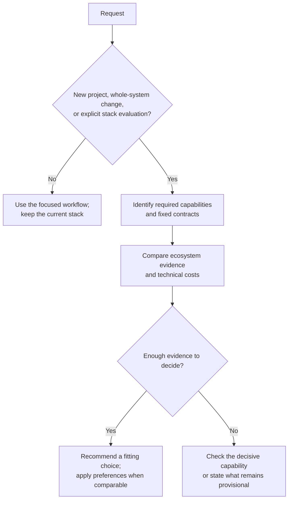

# Stack Selection

Choose the ecosystem that meets the requirements with the least unnecessary
implementation and integration work. Use personal defaults when suitable;
explain a different choice with concrete technical reasons.

## Decision rules

- Respect explicit user choices and required platform, runtime, and compatibility
  contracts. Surface conflicts rather than silently replacing a requirement.
- Compare actual libraries and tools before choosing a language. A domain label
  or popularity ranking is not evidence of feature coverage.
- Keep supported existing choices unless the requested change justifies replacing
  them. For a rewrite, compare retaining or incrementally adapting the current stack.
- Use TypeScript/Rust preferences when technical fit and lifecycle costs are
  comparable. Exclude team experience, familiarity, staffing, and training cost.

These rules apply to every reference and diagram. Diagram leaves identify
candidates, not mandates; investigate cases the diagrams do not cover.

## Workflow

1. Establish the deliverable, required operations, target platforms, distribution,
   and contracts. Resolve unknowns only when they could materially change the choice.
2. Read [language selection](references/languages.md), then only the relevant
   references below. Compare credible alternatives on feature coverage, ecosystem
   maintenance, integration, deployment, and technical maintenance costs.
3. Verify decisive claims against version-matched official sources. If capability
   coverage is uncertain, use a small representative check. Select current stable
   compatible versions; plan to record them in project config and lockfiles.
4. Return the choice, main tradeoffs, supporting links, open questions, and checks
   needed before adoption. For a rewrite or port, include parity, migration, and
   rollback. Selection alone does not authorize installation, implementation, or Git changes.

## References

| Read when | Reference |
| --- | --- |
| Choosing languages or researching an unfamiliar domain | [Languages and ecosystem fit](references/languages.md) |
| Selecting environments, hooks, workspaces, or release tooling | [Toolchain](references/toolchain.md) |
| TypeScript libraries or web tooling are involved | [TypeScript](references/typescript.md) |
| Choosing web frameworks, rendering, styles, or shared state | [Web](references/web.md) |
| Choosing service capabilities and integration boundaries | [Backend](references/backend.md) |
| React is a candidate or already selected | [React](references/react.md) |
| Evaluating Rust | [Rust](references/rust.md) |
| Evaluating Go | [Go](references/go.md) |
| Evaluating shared application UI with Flutter/Dart | [Flutter](references/flutter.md) |
| Evaluating Android, JVM, or Kotlin Multiplatform | [Kotlin](references/kotlin.md) |
| Evaluating Apple applications and native integrations | [Swift](references/swift.md) |

For React applications, use the web and TypeScript references alongside React.
For mixed stacks, read the relevant ecosystem references and define the boundary.
Technical sources were reviewed on 2026-10-15; recheck relevant releases and integrations.

## Output and evidence

Lead with the recommendation. Use a short comparison when alternatives matter:
required capability, candidate, evidence, and technical cost. Separate verified
support, assumptions, and personal preferences; date decisive external evidence.
Use the repository's decision record format when available.

Scale investigation to the decision. A design request needs justified choices
and a verification plan, not installation of the proposed stack. Reference
validation lists describe adoption checks: packed consumers for libraries,
production routes for sites, and target execution for native tools. Report
checks actually run separately from planned checks.

## Related skills

- [`vp-autodev`](https://github.com/VdustR/skills/tree/main/skills/vp-autodev)
  when the selected design proceeds through authorized implementation and delivery.
- [`vp-deps-migrate`](https://github.com/VdustR/skills/tree/main/skills/vp-deps-migrate)
  when an isolated dependency replacement or migration mechanics own the next step.
- [`vp-typescript-best-practices`](https://github.com/VdustR/skills/tree/main/skills/vp-typescript-best-practices)
  when implementing or reviewing TypeScript type boundaries.
- [`vp-design-reasoning`](https://github.com/VdustR/skills/tree/main/skills/vp-design-reasoning)
  when conceptual boundaries, workflow ownership, or architecture scenarios
  need clarification before or alongside technology selection.
